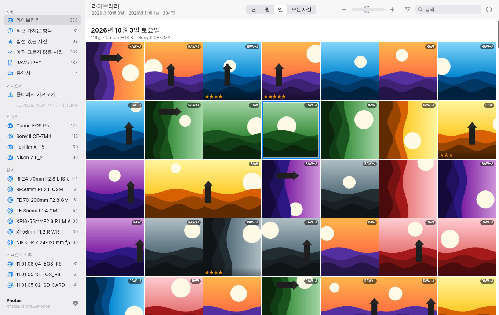

<div align="center">

# Photo Organize

**SD 카드를 꽂으면, 외장 하드로 옮기면서 알아서 정리되는 사진 앱**

EXIF 를 읽어 날짜별 폴더로 정리하고 · RAW 와 JPEG 를 한 장으로 묶고 · F1~F5 로 별점을 매겨 셀렉합니다.<br>
편집 기능은 없습니다. **가져오기 · 정리 · 셀렉 · 찾기** 에만 집중한, Rust 로 만든 빠른 데스크톱 앱입니다.

[](https://github.com/MJ-best/exif-photo-organize/actions/workflows/build.yml)


[](LICENSE)


</div>

---

## 목차

1. [이런 분께 필요합니다](#이런-분께-필요합니다)
2. [한눈에 보는 사용 흐름](#한눈에-보는-사용-흐름)
3. [설치](#설치)
4. [처음 사용하기](#처음-사용하기)
5. [셀렉: 별점으로 고르기](#셀렉-별점으로-고르기)
6. [찾기: 필터 · 검색 · 태그](#찾기-필터--검색--태그)
7. [RAW + JPEG — "어느 게 원본이지?"](#raw--jpeg--어느-게-원본이지)
8. [다른 프로그램과 함께 쓰기](#다른-프로그램과-함께-쓰기)
9. [단축키](#단축키)
10. [설정](#설정)
11. [내 사진은 안전한가요?](#내-사진은-안전한가요)
12. [지원 형식](#지원-형식)
13. [자주 묻는 질문 · 문제 해결](#자주-묻는-질문--문제-해결)
14. [성능](#성능)
15. [명령줄 도구 `photoorg`](#명령줄-도구-photoorg)
16. [개발자 안내](#개발자-안내)
17. [알려진 제한](#알려진-제한)

---

## 이런 분께 필요합니다

| 늘 겪던 일 | Photo Organize 에서는 |
|---|---|
| SD 카드를 외장 하드에 통째로 복사해 두고, 정리는 "나중에"… | 카드를 꽂으면 가져오기 화면이 뜨고, **복사하는 동시에 날짜별 폴더로 정리**됩니다. |
| 같은 카드를 또 복사해서 중복 파일이 쌓인다 | 이미 가져온 사진은 **자동으로 건너뜁니다.** 카드 화면에 `가져옴` 으로 표시돼요. |
| `IMG_0001.CR3` 와 `IMG_0001.JPG` 가 따로 놀아서 뭐가 원본인지 헷갈린다 | 둘은 **사진 한 장**으로 묶이고, 어떤 파일이 **RAW 원본**이고 어떤 게 **카메라 JPEG** 인지 바로 보입니다. |
| 셀렉하려면 무거운 편집 프로그램을 열어야 한다 | 가볍게 열어서 **F1~F5** 만 누르면 됩니다. 별점은 Lightroom 등에서도 그대로 보여요. |
| "그때 그 85mm 로 찍은 사진" 을 찾기 어렵다 | **카메라 · 렌즈 · ISO · mm · f · 셔터 · 별점 · 날짜**로 즉시 필터링됩니다. |
| 정리해 둬도 나중에 데이터로 쓰기 어렵다 | EXIF 로 **자동 태그**가 붙고, 카탈로그를 **CSV** 로 내보낼 수 있습니다. |

---

## 한눈에 보는 사용 흐름

```
① 앱을 연다   →   ② SD 카드를 꽂는다   →   ③ [새 항목 모두 가져오기]   →   ④ F1~F5 로 셀렉
```

**② 카드를 꽂으면 가져오기 화면이 자동으로 열립니다.** 카드 속 사진이 날짜별로 보이고, 새 사진 수 · 용량 · RAW+JPEG 쌍 수 · 촬영 기간 · 카메라가 요약됩니다.


**③ 가져오기를 누르면** 복사 · 체크섬 검증 · 폴더 정리 · EXIF 태그 생성 · 썸네일 만들기가 **한 번에** 진행되고, 가져온 사진은 그 즉시 라이브러리에 나타납니다. 진행 중에도 다른 사진을 둘러볼 수 있어요.


**④ 사진을 크게 보며 F1~F5 로 별점을 매깁니다.** `Z` 또는 클릭으로 100% 확대해 초점을 확인하고, ← → 로 넘깁니다.


---

## 설치

### macOS (맥북) — 권장

Apple Silicon(M1·M2·M3·M4)과 Intel 맥 모두에서 실행되는 **유니버설 앱** 하나로 제공됩니다. macOS 11 이상.

1. **[Releases](https://github.com/MJ-best/exif-photo-organize/releases/latest)** 에서 `photo-organize-macos-universal.dmg` 를 내려받습니다.
2. *(최신 개발 버전을 원하면)* [Actions → build](https://github.com/MJ-best/exif-photo-organize/actions/workflows/build.yml) 에서 가장 최근의 초록색(✓) 실행 → **Artifacts** 의 `photo-organize-macos-universal` 을 받아 압축을 풉니다. *(GitHub 로그인 필요)*
3. `.dmg` 를 열고 **Photo Organize** 를 **Applications** 폴더로 끌어 놓습니다.
4. **처음 한 번은 우클릭 → 열기 → 열기** 로 실행합니다.
   개발자 인증서로 서명된 앱이 아니어서 그냥 더블클릭하면 macOS 가 막습니다.
   macOS 15(Sequoia) 이상에서는 한 번 실행을 시도한 뒤 **시스템 설정 → 개인정보 보호 및 보안** 맨 아래의 **"그래도 열기"** 를 누르세요.
5. SD 카드나 외장 하드에 처음 접근할 때 *"이동식 볼륨의 파일에 접근하려고 합니다"* 창이 뜨면 **허용**을 누릅니다.

> 새 버전 릴리스: `Cargo.toml` 의 `version` 을 올리고 `docs/releases/v<버전>.md` 에 릴리스 노트를 써서 main 에 머지하면, CI 가 빌드한 뒤 태그와 [Releases](https://github.com/MJ-best/exif-photo-organize/releases) 를 자동으로 만듭니다. 태그(`v*`)를 직접 푸시하거나 *Actions → build → Run workflow* 에서 `release_tag` 를 입력해도 됩니다.

### Windows · Linux

[Releases](https://github.com/MJ-best/exif-photo-organize/releases/latest) 의 `photo-organize-windows-x86_64.zip` / `photo-organize-linux-x86_64.tar.gz` 를 받아 `photo-organize` 를 실행합니다.
Windows 에서 *"Windows의 PC 보호"* 창이 뜨면 **추가 정보 → 실행** 을 누르세요.
Linux 는 X11/Wayland, Vulkan 또는 OpenGL 드라이버(Mesa), `libxkbcommon-x11` 이 필요합니다.

### 직접 빌드

[Rust](https://rustup.rs) 1.95 이상이 필요합니다.

```bash
git clone https://github.com/MJ-best/exif-photo-organize.git
cd exif-photo-organize
cargo run --release -p photoorg-app          # 앱 실행

# macOS .app 만들기
cargo build --release -p photoorg-app
./scripts/macos-bundle.sh target/release/photo-organize dist   # → dist/Photo Organize.app
```

---

## 처음 사용하기

### 1. 라이브러리 폴더 정하기

처음 실행하면 사진을 보관할 **라이브러리 폴더**를 고릅니다. 외장 하드 안의 폴더를 권장합니다 (예: `/Volumes/외장하드/Photos`). 없는 폴더를 고르면 새로 만듭니다.

- 라이브러리는 **평범한 폴더**입니다. 정리된 사진은 날짜별 하위 폴더에 그대로 들어가므로 Finder 나 다른 앱에서도 바로 열 수 있습니다.
- 카탈로그(별점·태그·검색용 정보)와 썸네일은 그 폴더 안의 숨김 폴더 `.photo-organize/` 에 저장됩니다.
  그래서 **외장 하드를 다른 컴퓨터에 꽂아도** 정리 상태가 그대로 따라갑니다.
- 외장 하드를 뺀 채로 앱을 열면 *"라이브러리를 찾을 수 없습니다"* 가 표시되고, **하드를 다시 꽂으면 자동으로 열립니다.**

### 2. SD 카드 가져오기

카드를 꽂으면 사이드바 **가져오기** 아래에 카드 이름이 나타나고 가져오기 화면이 열립니다. *(설정에서 자동 열기를 끌 수 있습니다.)*
카드가 아닌 일반 폴더(예: 예전에 통째로 복사해 둔 폴더)는 **폴더에서 가져오기…** 로 같은 방식으로 정리할 수 있습니다.

| 가져오기 옵션 | 설명 |
|---|---|
| **폴더 구조** | `연도/날짜` (2026/2026-11-01, 기본) · `연/월/일` · `연도/날짜/카메라` · `카메라/연도/날짜` · `연도/월` |
| **파일 이름** | 원본 이름 유지 (기본) · `20261101_142530_IMG_0001` · `2026-11-01_IMG_0001` |
| **RAW 는 'RAW' 하위 폴더에** | 켜면 RAW 파일만 `…/2026-11-01/RAW/` 로 따로 모읍니다. 앱 안에서는 여전히 JPEG 와 한 장으로 묶입니다. |
| **동영상 포함** | MP4·MOV 등도 날짜별로 함께 정리합니다. |
| **복사 후 체크섬 검증** | 디스크에 기록을 확정(fsync)한 뒤 다시 읽어 체크섬을 비교합니다. 권장. |
| **완료 후 카드 추출** | 가져오기가 문제없이 끝나면 카드를 안전하게 꺼냅니다. |

일부만 가져오려면 사진을 클릭해 고른 뒤 **선택 항목 가져오기**를 누르세요. 날짜 옆 **모두 선택**으로 하루치를 한 번에 고를 수 있습니다.

### 3. 이렇게 정리됩니다

```
외장하드/Photos/                     ← 라이브러리 폴더
├── 2026/
│   ├── 2026-10-03/
│   │   ├── IMG_1101.JPG             ← 카메라 JPEG
│   │   ├── IMG_1102.JPG
│   │   └── RAW/                     ← (옵션) RAW 하위 폴더
│   │       ├── IMG_1101.CR3         ← RAW 원본
│   │       └── IMG_1101.xmp         ← 별점·태그 (Lightroom 호환)
│   └── 2026-10-04/
│       └── …
└── .photo-organize/                 ← 숨김: 카탈로그와 썸네일
    ├── catalog.db
    └── thumbs.db
```

- 촬영 날짜는 EXIF 의 *DateTimeOriginal* 을 씁니다. EXIF 가 없는 파일(동영상 등)은 파일 수정 시간을 씁니다.
- 카메라 파일 번호가 한 바퀴 돌아 같은 이름이 이미 있으면 `IMG_0001_1.JPG` 처럼 바꾸며, **RAW 와 JPEG 는 함께** 바꿔 쌍이 깨지지 않습니다.

---

## 셀렉: 별점으로 고르기


| 키 | 동작 |
|---|---|
| **F1 ~ F5** (또는 1~5) | 별점 1~5개 |
| **0** (또는 F6) | 별점 지우기 |
| **Space / Enter** | 크게 보기 ↔ 돌아가기 |
| **← →** | 이전 / 다음 사진 |
| **Z** 또는 클릭 | 100% 확대 (드래그로 이동) |

- 그리드에서 여러 장을 선택(⌘/Ctrl·Shift 클릭, Shift+방향키)한 뒤 누르면 **한 번에** 적용됩니다.
- 별점을 매기면 화면 가운데에 ★ 표시가 잠깐 떠서 확인할 수 있습니다.
- 설정의 **"별점을 매기면 다음 사진으로 이동"** 을 켜면 키 한 번에 다음 사진으로 넘어가 셀렉이 훨씬 빨라집니다.
- 카메라에서 미리 매긴 별점(EXIF·XMP)도 가져올 때 그대로 읽어 옵니다.

<br clear="right">

**추천 셀렉 루틴**

1. 가져오기가 끝나면 사이드바의 **최근 가져온 항목**을 엽니다.
2. 첫 사진에서 **Space** 로 크게 보고, ← → 로 넘기며 **F1~F5** 로 1차 셀렉합니다. 애매하면 **Z** 로 초점을 확인하세요.
3. 필터 바에서 **별점 → ★3개 이상**으로 좁힌 뒤 한 번 더 추립니다.
4. 남은 사진을 **⌘/Ctrl+A** 로 모두 선택하고, 정보 패널의 **내보내기 → JPEG 만** 으로 보정·공유용 폴더에 복사합니다.

---

## 찾기: 필터 · 검색 · 태그


툴바의 깔때기 아이콘을 누르면 필터 바가 열립니다. 각 항목에는 **지금 조건에서 해당하는 사진 수**가 함께 표시돼서, 고르기 전에 결과를 미리 알 수 있습니다.

| 필터 | 고르는 방법 |
|---|---|
| **카메라 · 렌즈** | 여러 개 체크 (그중 하나라도 맞으면 표시) |
| **ISO** | 빠른 선택(≤400 · 400–1600 · 1600–6400 · ≥6400) 또는 실제 값 목록 |
| **초점거리** | 초광각 <21mm · 광각 21–35 · 표준 35–70 · 준망원 70–135 · 망원 135–300 · 초망원 >300, 또는 mm 값 |
| **조리개** | ≤ƒ/2 · ƒ/2–4 · ƒ/4–8 · ≥ƒ/8, 또는 ƒ 값 |
| **셔터** | 고속 ≤1/1000 · 1/1000–1/125 · 1/125–1/30 · 저속 1/30–1s · 장노출 ≥1s, 또는 실제 값 |
| **별점** | ★1개 이상 … ★5개, 별점 없음 |
| **형식** | RAW+JPEG · RAW 있음 · JPEG/HEIF만 · 사진 · 동영상 |
| **태그** | 자동 태그 + 직접 붙인 태그 (선택한 태그를 **모두** 가진 사진) |

- **검색창**(⌘/Ctrl+F)은 파일 이름 · 카메라 · 렌즈 · 태그를 함께 찾습니다.
- **날짜**는 상단의 **연 · 월 · 일 · 모든 사진** 으로 탐색합니다. 연도 카드 → 월 카드 → 그날의 사진으로 바로 내려갑니다.
- **사이드바**에서 자주 쓰는 범위를 한 번에 엽니다: 라이브러리 · 최근 가져온 항목 · 별점 있는 / 아직 고르지 않은 사진 · RAW+JPEG · 동영상 · **카메라별** · **렌즈별** · **가져오기 기록**(카드별).

### 자동 태그

가져올 때 EXIF 를 읽어 아래 태그를 자동으로 붙입니다. 필터 · 검색에 쓰이고, XMP 사이드카와 CSV 에도 들어가서 나중에 데이터로 활용할 수 있습니다.

| 분류 | 값 |
|---|---|
| 카메라 / 렌즈 | `카메라:Canon EOS R5`, `렌즈:RF24-70mm F2.8 L IS USM` |
| 화각 (35mm 환산) | 초광각 · 광각 · 표준 · 준망원 · 망원 · 초망원 |
| 감도 | 저감도(≤400) · 중감도(≤1600) · 고감도(≤6400) · 초고감도 |
| 조리개 | 개방(≤ƒ/2.8) · 중간 · 조임(≥ƒ/8) |
| 셔터 | 고속(≤1/1000) · 일반 · 저속(>1/30) · 장노출(≥1s) |
| 시간대 · 계절 | 새벽 · 아침 · 낮 · 저녁 · 밤 / 봄 · 여름 · 가을 · 겨울 |
| 방향 · 형식 | 가로 · 세로 · 정방형 / RAW+JPEG · RAW · JPEG · HEIF · 동영상 |
| 기타 | 플래시 · 위치정보 · 노출보정 ± |

정보 패널(⌘/Ctrl+I)에서 **직접 태그**를 추가하고 지울 수 있습니다. 여러 장을 선택하면 한 번에 붙습니다.

---

## RAW + JPEG — "어느 게 원본이지?"

- 같은 이름의 RAW 와 JPEG(`IMG_0001.CR3` + `IMG_0001.JPG`)는 **한 장의 사진**으로 다룹니다. 별점도 한 번만 매기면 됩니다.
- 썸네일 오른쪽 위 배지로 구성을 바로 알 수 있습니다: `RAW+J` · `RAW` · (배지 없음 = JPEG)
- **정보 패널**에 파일별 역할이 표시됩니다:
  - **RAW 원본** — 카메라가 기록한 센서 데이터
  - **JPEG (카메라 현상)** — 카메라가 RAW 로 만든 JPEG
  - **JPEG 원본** — RAW 없이 JPEG 로만 찍은 사진

  경로를 클릭하면 Finder/탐색기에서 파일 위치가 열리고, 마우스를 올리면 원래 카드 위치 · 원래 파일명 · 체크섬이 보입니다.
- **듀얼 슬롯**(카드1 = RAW, 카드2 = JPEG)으로 따로 가져와도 이름 · 촬영 시각 · 카메라가 같으면 자동으로 같은 사진에 합쳐집니다.
- RAW 를 `RAW/` 하위 폴더에 따로 두어도(이 앱의 옵션이든 직접 정리한 폴더든) 한 장으로 묶입니다.
- 공유할 때는 **내보내기 → JPEG 만**, 보정할 때는 **원본 전체**를 고르면 됩니다.

---

## 다른 프로그램과 함께 쓰기

- **Lightroom · Capture One · Bridge · darktable · digiKam**: 별점과 태그를 표준 **XMP 사이드카**(`IMG_0001.xmp`, RAW 옆)에도 기록합니다.
  라이브러리 폴더를 그대로 불러오면 별점이 보입니다. 키워드는 `카메라|Canon EOS R5` 처럼 계층 키워드로도 들어갑니다.
  다른 앱이 이미 만든 사이드카는 **보정값을 지우지 않고 별점만** 고칩니다.
- **Finder · 탐색기**: 라이브러리는 평범한 날짜별 폴더라 어떤 앱으로도 열 수 있습니다.
- **엑셀 · 스프레드시트**: 설정 → **카탈로그 CSV로 내보내기**로 사진별 촬영 시각 · 카메라 · 렌즈 · mm · ƒ · 셔터 · ISO · 별점 · 형식 · 파일 경로 · 태그 · GPS 를 한 줄씩 받을 수 있습니다.
- **고른 사진 넘기기**: 그리드 우클릭 또는 여러 장 선택 → 정보 패널 → **내보내기**(원본 전체 / JPEG 만). 이름이 겹치면 덮어쓰지 않고 `_1` 을 붙입니다.

---

## 단축키

| 키 | 동작 |
|---|---|
| **F1 – F5** / **1 – 5** | 별점 1 – 5 (선택한 사진 전체, 또는 크게 보고 있는 사진) |
| **0** / **F6** / **`** | 별점 지우기 |
| **Space** / **Enter** / 더블클릭 | 크게 보기 ↔ 돌아가기 |
| **← → ↑ ↓** | 이동 (Shift 와 함께: 범위 선택) |
| **Z** / 클릭 | 100% 확대 (크게 보기에서), 드래그로 이동 |
| 스크롤 / 스와이프 | 이전·다음 사진 (크게 보기에서) |
| **⌘/Ctrl + 1 · 2 · 3 · 4** | 연 · 월 · 일 · 모든 사진 |
| **⌘/Ctrl + I** | 정보 패널 |
| **⌘/Ctrl + F** | 검색 |
| **⌘/Ctrl + A** | 모두 선택 |
| **⌘/Ctrl + + / −**, ⌘/Ctrl + 스크롤 | 썸네일 크기 |
| **Esc** | 선택 해제 / 크게 보기 닫기 |
| 우클릭 | 별점 · 파일 위치 보기 · 내보내기 |

> **맥북에서 F1~F5 가 밝기·음량 키로 동작하면** `fn` 과 함께 누르거나 숫자 **1~5** 를 쓰세요.
> 시스템 설정 → 키보드 → 키보드 단축키 → 기능 키에서 *"F1, F2 등의 키를 표준 기능 키로 사용"* 을 켜도 됩니다.

---

## 설정

사이드바 아래 ⚙ 버튼.

| 항목 | 기본값 | 설명 |
|---|---|---|
| 테마 | 다크 | 다크 · 라이트 · 시스템 |
| 썸네일을 정사각형으로 자르기 | 켬 | 끄면 「사진」 앱의 *원본 비율 그리드*처럼 사진 전체가 보입니다 |
| 사진 보기에서 필름 스트립 표시 | 켬 | 크게 보기 아래 썸네일 줄 |
| 별점을 매기면 다음 사진으로 이동 | 끔 | 빠른 셀렉용 |
| 별점·태그를 XMP 사이드카에 기록 | 켬 | Lightroom/Capture One 호환 |
| SD 카드를 연결하면 가져오기 화면 열기 | 켬 | |
| 가져오기가 끝나면 카드 추출 | 끔 | |
| 카탈로그 CSV로 내보내기 / 썸네일 모두 다시 만들기 | | |

<p align="center">
  
  
</p>

앱 설정 파일 위치: macOS `~/Library/Application Support/photo-organize/config.json` · Windows `%APPDATA%\photo-organize\config.json` · Linux `~/.config/photo-organize/config.json`

---

## 내 사진은 안전한가요?

- **SD 카드는 읽기만 합니다.** 카드의 파일을 지우거나 바꾸지 않습니다. (추출은 버튼이나 옵션으로 요청할 때만)
- **원본 사진 파일은 절대 수정하지 않습니다.** 별점·태그는 카탈로그와 별도의 `.xmp` 파일에만 기록합니다.
- **복사는 임시 파일(`.파일명.part`)에 쓴 뒤 이름을 바꿉니다.** 중간에 케이블이 빠지거나 앱이 꺼져도 반쯤 복사된 사진이 진짜 사진처럼 남지 않습니다.
- **체크섬 검증**: 복사하면서 BLAKE3 체크섬을 계산하고, 디스크에 기록을 확정한 뒤 다시 읽어 비교합니다. 크기나 체크섬이 다르면 그 파일을 실패로 표시하고 남은 파일은 계속 가져옵니다.
- **중복 방지**: 파일명 · 크기 · 촬영 시각으로 빠르게 확인하고, 내용 체크섬으로 한 번 더 확인합니다.
- **가져오기를 중단하면** 반쯤 복사된 사진 묶음은 지우고, 이미 끝난 사진만 라이브러리에 남깁니다.
- **인터넷을 쓰지 않습니다.** 정보 패널의 *지도* 를 누를 때만 브라우저로 지도 페이지를 엽니다.

**카탈로그를 잃어버렸다면?** `.photo-organize` 폴더가 지워져도 사진은 그대로입니다.
**폴더에서 가져오기…** 로 라이브러리 폴더 자신을 고르면 파일을 복사하지 않고 그 자리에서 다시 카탈로그를 만들고, `.xmp` 에 남아 있던 **별점도 복원**됩니다.

**백업은?** 라이브러리 폴더 전체(숨김 폴더 `.photo-organize` 포함)를 다른 하드로 복사하면 그대로 열립니다.

---

## 지원 형식

| 종류 | 확장자 | 촬영 정보(EXIF) | 썸네일 · 크게 보기 |
|---|---|---|---|
| JPEG | jpg · jpeg | ✅ | ✅ (카메라가 넣어 둔 MPF 미리보기를 우선 사용) |
| Canon | CR3 · CR2 · CRW | ✅ | ✅ 내장 JPEG (CR3: 전체 해상도 · PRVW · THMB) |
| Nikon | NEF · NRW | ✅ | ✅ 내장 JPEG |
| Sony | ARW · SR2 · SRF | ✅ | ✅ 내장 JPEG |
| Fujifilm | RAF | ✅ | ✅ 내장 JPEG |
| Panasonic · Olympus/OM · Pentax · Samsung · Leica · Hasselblad · Phase One | RW2 · ORF · PEF · SRW · DNG · 3FR · IIQ … | ✅ | ✅ 내장 JPEG |
| HEIF | heic · heif · hif | ✅ | 아이콘으로 표시 |
| 동영상 | mp4 · mov · m4v · mts · m2ts · avi … | 파일 시간 | 아이콘으로 표시 |

읽어 오는 정보: 촬영 시각(1/1000초, 시간대) · 카메라 · 렌즈 · 초점거리(35mm 환산 포함) · 조리개 · 셔터 · ISO · 노출보정 · 플래시 · 화이트밸런스 · 측광 · 크기 · 방향 · GPS · 시리얼 · 카메라 별점.
렌즈 모델명을 기록하지 않는 오래된 바디는 렌즈 사양(예: `24-70mm f/2.8`)으로 표시합니다.

---

## 자주 묻는 질문 · 문제 해결

<details>
<summary><b>"손상되었기 때문에 열 수 없습니다" 또는 "Apple이 확인할 수 없습니다"라고 나와요 (macOS)</b></summary>

개발자 인증서로 서명되지 않은 앱이라 생기는 메시지입니다.
1. Finder 에서 앱을 **우클릭 → 열기 → 열기**.
2. 그래도 안 되면 **시스템 설정 → 개인정보 보호 및 보안** 아래쪽의 **"그래도 열기"**.
3. 그래도 *손상되었다* 고 나오면 터미널에서 다운로드 표시를 지웁니다:
   ```bash
   xattr -dr com.apple.quarantine "/Applications/Photo Organize.app"
   ```
</details>

<details>
<summary><b>SD 카드를 꽂았는데 아무 반응이 없어요</b></summary>

- 카드에 `DCIM` 폴더가 있어야 카메라 카드로 인식합니다. (디지털카메라 카드는 모두 있습니다)
- 앱이 카드 목록을 1.5초마다 확인합니다. 잠시 기다려 보세요.
- macOS 에서 *이동식 볼륨* 접근을 거절했다면 **시스템 설정 → 개인정보 보호 및 보안 → 파일 및 폴더 → Photo Organize → 이동식 볼륨**을 켜 주세요.
- 설정의 *"SD 카드를 연결하면 가져오기 화면 열기"* 가 꺼져 있으면 사이드바의 카드 이름을 직접 누르세요.
- 카드 리더가 아닌 폴더라면 **폴더에서 가져오기…** 를 쓰세요.
</details>

<details>
<summary><b>같은 카드를 또 꽂으면 어떻게 되나요?</b></summary>

이미 가져온 사진은 카드 화면에서 `가져옴` 으로 흐리게 표시되고, **새 항목 모두 가져오기**는 새 사진만 복사합니다. *가져온 항목 숨기기* 로 새 사진만 볼 수도 있습니다.
</details>

<details>
<summary><b>예전에 그냥 복사해 둔 사진 폴더도 정리할 수 있나요?</b></summary>

네. **폴더에서 가져오기…** 로 그 폴더를 고르면 SD 카드처럼 날짜별로 **복사해서** 정리합니다. 원래 폴더는 건드리지 않으니, 확인한 뒤 직접 지우시면 됩니다.
고른 폴더가 라이브러리 **안**에 있으면 복사하지 않고 그 자리에서 카탈로그에만 추가합니다.
</details>

<details>
<summary><b>별점은 어디에 저장되나요? Lightroom 에서도 보이나요?</b></summary>

라이브러리의 카탈로그(`.photo-organize/catalog.db`)와 사진 옆의 `.xmp` 사이드카 두 곳에 저장됩니다. Lightroom 에서 라이브러리 폴더를 가져오기(추가)하면 별점이 보입니다. 이미 Lightroom 에 있는 사진이라면 *메타데이터 → 파일에서 메타데이터 읽기* 를 실행하세요.
</details>

<details>
<summary><b>촬영 날짜가 이상하게 나와요</b></summary>

카메라 시계가 틀렸거나, EXIF 가 없는 파일이라 파일 수정 시간을 쓴 경우입니다. 정보 패널에 *EXIF 날짜 없음 · 파일 시간 사용* 이 보이면 후자입니다.
</details>

<details>
<summary><b>썸네일이 안 보이거나 깨져 있어요</b></summary>

설정 → **썸네일 모두 다시 만들기**를 눌러 보세요. HEIF 와 동영상은 원래 아이콘으로만 표시됩니다.
</details>

<details>
<summary><b>외장 하드를 바꾸거나 다른 컴퓨터에서 열고 싶어요</b></summary>

라이브러리 폴더를 통째로(숨김 폴더 포함) 옮긴 뒤, 사이드바 아래의 라이브러리 이름을 눌러 새 위치를 고르면 됩니다. 파일 경로는 라이브러리 기준 상대 경로로 저장되어 있어 드라이브 이름이 달라도 문제없습니다.
</details>

---

## 성능

| 항목 | 수치 |
|---|---|
| 사진 10만 장 라이브러리에서 필터 적용 | ~2 ms |
| 필터별 사진 수(패싯) 계산 | ~2 ms |
| 텍스트 검색 | ~6 ms |
| 썸네일 — RAW 내장 미리보기 · MPF 가 있는 JPEG | 수 ms |
| 썸네일 — 미리보기 없는 24MP JPEG | ~45 ms (여러 코어에서 병렬) |

어떻게 빠른가:

- **RAW 를 현상하지 않습니다.** 모든 카메라 RAW 에 들어 있는 미리보기 JPEG 중 필요한 크기 이상에서 가장 작은 것을 골라, JPEG 의 1/2·1/4·1/8 축소 디코딩으로 바로 엽니다.
- **EXIF 는 필요한 바이트만 읽습니다.** 50 MB RAW 를 통째로 읽지 않으므로 수천 장이 든 SD 카드도 몇 초 만에 훑습니다.
- **카드 읽기와 하드 쓰기를 동시에** 합니다(4 MB 단위 파이프라인). 그래서 둘 중 느린 장치의 속도로 복사가 끝납니다.
- 썸네일은 작은 파일 수천 개 대신 **SQLite 파일 하나**에 모아 exFAT 외장 하드에서도 빠릅니다.
- 그리드는 **화면에 보이는 썸네일만** 백그라운드에서 디코딩하고, 빠르게 스크롤해 지나간 요청은 버립니다. 크게 보기에서는 앞뒤 사진을 미리 불러옵니다.

---

## 명령줄 도구 `photoorg`

스크립트나 서버, 문제 확인용으로 같은 기능을 명령줄에서도 쓸 수 있습니다.

```bash
photoorg volumes                                         # 연결된 SD 카드 목록
photoorg scan   /Volumes/EOS_DIGITAL /Volumes/HDD/Photos  # 가져오기 전 미리보기 (새 사진·중복 수)
photoorg import /Volumes/EOS_DIGITAL /Volumes/HDD/Photos --raw-subfolder RAW
        # --folders "{YYYY}/{MM}/{DD}"  --names "{YYYY}{MM}{DD}_{orig}"  --no-videos  --no-verify
photoorg list   /Volumes/HDD/Photos --camera r5 --lens 85 --iso 100-800 --focal 35-85 --aperture 1.2-2.8 --min-rating 4 --format raw+jpeg
photoorg stats  /Volumes/HDD/Photos                       # 카메라 · 렌즈 · ISO · 별점 통계
photoorg rate   /Volumes/HDD/Photos 5 12 13 14            # 사진 id 12·13·14 에 별점 5 (XMP 포함)
photoorg export-csv /Volumes/HDD/Photos catalog.csv       # 엑셀용 CSV (UTF-8 BOM)
photoorg thumbs /Volumes/HDD/Photos [--all]               # 빠진 썸네일 만들기
photoorg info   IMG_0001.CR3                              # EXIF 와 내장 미리보기 정보 (디버그)
```

폴더·파일 이름 템플릿에 쓸 수 있는 값: `{YYYY}` `{YY}` `{MM}` `{DD}` `{hh}` `{mm}` `{ss}` `{camera}` `{make}` `{lens}` `{orig}`

---

## 개발자 안내

### 구조

```
crates/
├── core/   photoorg-core   — 앱과 CLI 가 함께 쓰는 라이브러리
│   ├── tiff.rs        seek 기반 TIFF/IFD 리더 (필요한 바이트만 읽음)
│   ├── metadata.rs    EXIF: JPEG(APP1 · XMP · MPF) · TIFF 계열 RAW · CR3(ISO-BMFF) · RAF · HEIF
│   ├── preview.rs     내장 JPEG 고르기 · DCT 축소 디코딩 · 방향 보정 · 썸네일
│   ├── import.rs      스캔 → RAW/JPEG 묶기 → 계획 → 복사 파이프라인 → 카탈로그 → 썸네일
│   ├── catalog.rs     SQLite 카탈로그 · 썸네일 DB · 메모리 인덱스(LibraryIndex)
│   ├── filter.rs      필터 · 패싯 계산 (rayon 병렬)
│   ├── library.rs     라이브러리 폴더 · XMP 기록 · 내보내기
│   ├── tags.rs · template.rs · xmp.rs · volumes.rs · format.rs · media.rs
├── app/    photo-organize  — egui/eframe 데스크톱 앱
│   ├── app.rs         상태 · 백그라운드 작업 · 키보드 · 프레임 루프
│   ├── thumbs.rs      비동기 텍스처 캐시 (보이는 것만, 오래된 요청 폐기)
│   ├── layout.rs      그리드 · 연/월 카드 배치
│   ├── views/         sidebar · toolbar · filters · grid · viewer · info · import
│   └── theme.rs · fonts.rs · widgets.rs · icon.rs
└── cli/    photoorg        — 명령줄 도구
```

### 설계에서 신경 쓴 점

- **카탈로그는 라이브러리 폴더 안에.** 경로는 라이브러리 기준 상대 경로라, 외장 하드가 다른 컴퓨터에서 다른 이름으로 붙어도 그대로 열립니다.
- **화면은 메모리 인덱스로.** 시작할 때 카탈로그 전체를 압축된 구조체로 읽어 두고(문자열은 정수로 바꿔 둠), 필터와 패싯을 전부 메모리에서 계산합니다. SQLite 는 저장용입니다.
- **쓰기는 별도 스레드.** 별점 · XMP 기록은 전용 스레드에서 처리해 외장 하드가 느려도 UI 가 멈추지 않습니다.
- **폰트는 OS 의 것.** SF Pro / Segoe UI 와 시스템 한글 글꼴(Apple SD Gothic Neo · 맑은 고딕 · Noto Sans CJK)을 OS 글꼴 데이터베이스에서 찾아 씁니다.
- **macOS 에서는** 타이틀바를 숨기고 콘텐츠를 창 전체로 넓혀, 「사진」 앱처럼 신호등 버튼이 사이드바 위에 떠 있습니다.

### 테스트

```bash
cargo test --workspace            # 단위 · 통합 테스트
cargo clippy --workspace          # 린트
cargo test --release -p photoorg-core bench_100k -- --ignored --nocapture   # 10만 장 필터 벤치마크
```

통합 테스트는 임시 폴더에 가짜 SD 카드를 만들어 실제 가져오기 파이프라인을 돌립니다: RAW+JPEG 묶기, 중복 건너뛰기, 이름 충돌, 듀얼 슬롯 병합, RAW 하위 폴더 재카탈로그 + XMP 별점 복원, 쓰기 실패 시 다른 파일에 영향 없음, 중단 시 남는 파일 없음, 내보내기.

### CI

`.github/workflows/build.yml` 이 PR · `main` 푸시 · `v*` 태그마다 실행됩니다. 첫 `plan` 작업이 릴리스 여부를 정합니다: `v*` 태그 푸시, *Run workflow* 의 `release_tag`, 또는 main 푸시 중 새 버전의 릴리스 노트(`docs/releases/v<버전>.md`)가 있고 그 태그가 아직 없을 때.
**macOS 를 먼저** 빌드(arm64 + x86_64 → `lipo` 유니버설 → `.app` → ad-hoc 서명 → `.dmg`/`.zip`)하고, 이어서 Windows · Linux 를 빌드합니다. 태그 푸시 시 Releases 에 자동 업로드합니다.

---

## 알려진 제한

- **HEIF/HEIC · 동영상**은 정리 · 필터 · 별점은 되지만 썸네일 대신 아이콘이 표시됩니다 (순수 Rust HEVC 디코더 부재).
- **사진 편집 기능은 의도적으로 없습니다.** 보정은 Lightroom 등에서 하세요. XMP 로 별점이 이어집니다.
- macOS 앱은 **Apple 개발자 서명 · 공증이 되어 있지 않아** 처음 실행할 때 한 번 허용이 필요합니다.
- 동영상의 촬영 날짜는 파일 수정 시간을 씁니다.

---

## 라이선스

[MIT](LICENSE)
