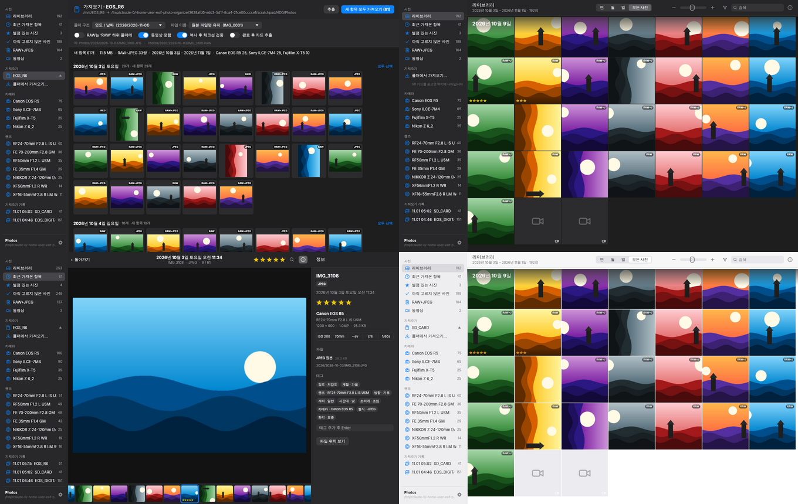

# Photo Organize

**SD 카드 → 외장 하드로 옮기면서, EXIF 기준으로 자동 정리하고, 별점으로 빠르게 셀렉하는 Rust 사진 정리 앱**

사진 편집 기능은 없습니다. *가져오기 · 정리 · 셀렉(별점) · 필터* 에만 집중합니다.
디자인은 macOS 기본 「사진」 앱을 따릅니다 (사이드바 / 연·월·일·모든 사진 / 정보 패널).



```
1. 앱을 연다
2. SD 카드를 꽂는다            → 카드가 자동 감지되고 가져오기 화면이 열립니다
3. [새 항목 모두 가져오기]      → 외장 하드로 복사 + 검증 + 날짜별 폴더 정리
                                 + EXIF 태그 생성 + 썸네일 갤러리가 동시에 만들어집니다
4. F1~F5 로 별점을 매기며 셀렉   → 카메라 · 렌즈 · ISO · mm · f · 셔터 · 별점으로 즉시 필터
```

## 주요 기능

### 가져오기 (SD 카드 → 외장 하드)
- **카드 자동 감지**: `DCIM` 폴더가 있는 볼륨(macOS `/Volumes`, Windows 드라이브, Linux `/media`)을 감시하다가 꽂는 순간 가져오기 화면을 엽니다.
- **가져오기 전 미리보기**: 카드 내용을 날짜별로 보여주고, 이미 가져온 사진은 `가져옴` 으로 표시합니다. 일부만 골라서 가져올 수도 있습니다.
- **복사와 정리를 한 번에**: 카드 읽기와 하드 쓰기를 별도 스레드로 겹쳐서(파이프라인) 느린 쪽 장치 속도로 복사합니다.
  복사하면서 BLAKE3 체크섬을 계산하고, `fsync` 후 다시 읽어 검증합니다. 임시 파일(`.part`)로 쓴 뒤 이름을 바꾸므로 중간에 끊겨도 깨진 파일이 남지 않습니다.
- **폴더 구조 템플릿**: `{YYYY}/{YYYY}-{MM}-{DD}` (기본), `{YYYY}/{MM}/{DD}`, `…/{camera}`, `{camera}/…` 등. 파일 이름 유지 또는 `날짜_시간_원본`.
- **중복 방지**: 같은 카드를 다시 꽂아도 이미 가져온 사진은 건너뜁니다 (파일명+크기+촬영시각 빠른 키 → 내용 해시 이중 확인).
  카메라 파일 번호가 한 바퀴 돌아 이름이 겹치면 `IMG_0001_1` 처럼 RAW/JPEG 쌍을 함께 이름 변경합니다.
- 동영상도 함께 날짜별로 정리 (옵션), 가져온 뒤 카드 자동 추출 (옵션), 기존 `.xmp` 사이드카도 같이 복사.

### "뭐가 원본이지?" — RAW + JPEG 묶음
- 같은 이름의 `IMG_0001.CR3` + `IMG_0001.JPG` 는 **사진 한 장(하나의 항목)** 으로 묶입니다. 썸네일에는 `RAW+J` 배지가 붙고,
  정보 패널에서 **RAW 원본** / **JPEG (카메라 현상)** 파일 경로·크기·원래 카드 위치·체크섬을 확인할 수 있습니다.
- 듀얼 슬롯(카드1=RAW, 카드2=JPEG)으로 따로 가져와도 이름·촬영시각·카메라가 같으면 자동으로 같은 사진에 합쳐집니다.
- 옵션으로 RAW 를 `RAW/` 하위 폴더에 분리 저장할 수 있습니다.

### 갤러리 & 셀렉
- 「사진」 앱과 같은 **연 / 월 / 일 / 모든 사진** 보기, 썸네일 크기 슬라이더(⌘+ / ⌘−, ⌘+스크롤).
- 사진 크게 보기(Space/Enter/더블클릭): 화면 크기에 맞춘 미리보기, 이웃 사진 미리 불러오기, 클릭/`Z` 로 **100% 확대(초점 확인)**, 필름 스트립.
- **별점: F1~F5 (또는 1~5), 0 으로 지우기.** 여러 장 선택 후 한 번에 적용. "별점을 매기면 다음 사진으로" 옵션.
- 별점과 태그는 **XMP 사이드카(`IMG_0001.xmp`)** 에도 기록 → Lightroom · Capture One · Bridge · darktable 에서 그대로 보입니다.
  다른 앱이 만든 사이드카는 보정값을 지우지 않고 `xmp:Rating` 만 갱신합니다. 카메라에서 매긴 별점(EXIF/XMP)도 가져옵니다.

### EXIF 필터 & 자동 태그
- 필터 바: **카메라 · 렌즈 · ISO · 초점거리(mm) · 조리개(f) · 셔터 · 별점 · 형식(RAW+JPEG/RAW/JPEG/동영상) · 태그** + 검색.
  각 필터는 현재 조건에서의 **사진 수**를 함께 보여줍니다(패싯 검색). 수만 장도 메모리 인덱스로 즉시 필터링됩니다.
- 사이드바: 라이브러리, 최근 가져온 항목, 별점 있는/없는 사진, RAW+JPEG, 동영상, **카메라별 · 렌즈별**, **가져오기 기록**.
- 자동 태그 (가져올 때 EXIF 로 생성, 나중에 데이터로 활용 가능):
  `카메라:` `렌즈:` `화각:초광각/광각/표준/준망원/망원` `감도:저감도…초고감도` `조리개:개방/중간/조임`
  `셔터:고속/일반/저속/장노출` `시간대:새벽/아침/낮/저녁/밤` `계절:` `방향:가로/세로` `형식:RAW+JPEG` `기타:플래시/위치정보`
- 직접 태그 추가/삭제, 카탈로그 전체를 **CSV 로 내보내기**(Excel 호환).
- 고른 사진 **내보내기**: 우클릭 또는 여러 장 선택 → 정보 패널에서 원본 전체 / JPEG 만 폴더로 복사.

### 지원 형식
| 종류 | 확장자 | 메타데이터 | 썸네일/미리보기 |
|---|---|---|---|
| JPEG | jpg jpeg | ✅ | ✅ (DCT 스케일 디코딩) |
| RAW (TIFF 계열) | CR2 NEF NRW ARW SR2 DNG ORF RW2 PEF SRW 3FR IIQ ERF … | ✅ | ✅ 내장 JPEG |
| Canon CR3 | cr3 | ✅ (CMT1–4) | ✅ (전체 해상도 JPEG / PRVW / THMB) |
| Fujifilm RAF | raf | ✅ | ✅ 내장 JPEG |
| HEIF | heic heif hif | ✅ | – (항목으로는 표시) |
| 동영상 | mp4 mov m4v mts … | 파일 시간 | – |

## 설계 / 성능
- **RAW 를 현상하지 않습니다.** 모든 카메라 RAW 에 들어 있는 내장 JPEG 미리보기를 찾아, 필요한 크기 이상인 것 중 가장 작은 것을 골라
  1/2·1/4·1/8 DCT 스케일로 디코딩합니다 → 썸네일 한 장에 수 ms.
- EXIF 는 **필요한 바이트만 seek 해서** 읽는 자체 TIFF 리더로 파싱합니다 (50MB RAW 를 통째로 읽지 않음 → SD 카드 스캔이 빠름).
- 카탈로그는 라이브러리 폴더 안 `.photo-organize/catalog.db`(SQLite, WAL)에, 썸네일은 `thumbs.db` 한 파일에 저장합니다.
  외장 하드를 다른 컴퓨터에 꽂아도 그대로 열립니다(경로는 라이브러리 기준 상대 경로). 작은 파일 수천 개 대신 한 파일이라 exFAT HDD 에서도 빠릅니다.
- UI 는 [egui](https://github.com/emilk/egui) (GPU 렌더링). 보이는 썸네일만 백그라운드 스레드에서 디코딩하고, 스크롤로 지나간 요청은 버립니다.

```
crates/
  core/   photoorg-core  — EXIF/RAW 파서, 미리보기, 가져오기 파이프라인, 카탈로그, 필터, XMP, 카드 감지
  app/    photo-organize — 데스크톱 GUI (eframe/egui)
  cli/    photoorg       — 명령줄 도구 (스크립트·서버·디버그용)
```

## 설치

- **빌드된 앱 받기**: GitHub Actions(`.github/workflows/build.yml`)가 macOS(arm64/x86_64) · Windows · Linux 용 실행 파일을 만듭니다.
  저장소의 *Actions* 탭에서 최신 실행의 아티팩트를 받거나, `v0.1.0` 같은 태그를 푸시하면 *Releases* 에 자동으로 올라갑니다.
- macOS: 압축을 풀어 `Photo Organize.app` 을 응용 프로그램 폴더로 옮기세요. 서명되지 않은 앱이라 처음 한 번은
  **우클릭 → 열기** 로 실행해야 합니다. SD 카드를 처음 읽을 때 "이동식 볼륨 접근" 허용 창이 뜨면 허용하세요.

## 빌드 & 실행

[Rust](https://rustup.rs) 1.85 이상이 필요합니다.

```bash
cargo run --release -p photoorg-app        # GUI 실행
cargo build --release                      # target/release/photo-organize, target/release/photoorg
cargo test                                 # 테스트
```

- macOS 앱 번들: `cargo build --release -p photoorg-app && scripts/macos-bundle.sh target/release/photo-organize dist`
- macOS / Windows 는 추가 의존성이 없습니다.
- Linux 는 X11/Wayland 와 Vulkan 또는 OpenGL 드라이버(`libxkbcommon-x11`, Mesa)가 필요합니다. 파일 선택 창은 XDG Desktop Portal 을 사용합니다.

처음 실행하면 **라이브러리 폴더**(예: `/Volumes/외장하드/Photos`)를 고릅니다. 없으면 새로 만듭니다.

## 단축키

| 키 | 동작 |
|---|---|
| **F1–F5** / 1–5 | 별점 1–5 (선택한 사진 전체 또는 보고 있는 사진) |
| 0 / F6 / \` | 별점 지우기 |
| Space / Enter / 더블클릭 | 크게 보기 ↔ 돌아가기 |
| ← → ↑ ↓ | 이동 (Shift: 범위 선택) |
| Z / 클릭 | 100% 확대 (크게 보기에서), 드래그로 이동 |
| ⌘/Ctrl + 1·2·3·4 | 연 · 월 · 일 · 모든 사진 |
| ⌘/Ctrl + I | 정보 패널 |
| ⌘/Ctrl + F | 검색 |
| ⌘/Ctrl + A | 모두 선택 |
| ⌘/Ctrl + + / − | 썸네일 크기 |
| Esc | 선택 해제 / 돌아가기 |

macOS 에서 F1–F5 가 밝기·키보드 조명 등으로 동작하면 `fn` 키와 함께 누르거나 숫자 1–5 를 사용하세요.

## 명령줄 도구 (`photoorg`)

```bash
photoorg volumes                                   # 연결된 SD 카드
photoorg scan /Volumes/EOS_DIGITAL ~/HDD/Photos    # 새 사진/중복 개수 미리보기
photoorg import /Volumes/EOS_DIGITAL ~/HDD/Photos --raw-subfolder RAW
photoorg list ~/HDD/Photos --camera r5 --iso 100-800 --focal 35-50 --min-rating 4
photoorg stats ~/HDD/Photos                        # 카메라/렌즈/ISO/별점 통계
photoorg rate ~/HDD/Photos 5 12 13 14              # asset id 에 별점
photoorg export-csv ~/HDD/Photos catalog.csv
photoorg info IMG_0001.CR3                         # EXIF + 내장 미리보기 정보 (디버그)
```

## 성능 (참고 수치)
- 사진 10만 장 라이브러리: 필터 ~2 ms, 패싯(필터별 개수) ~2 ms, 텍스트 검색 ~6 ms (`cargo test --release -p photoorg-core bench_100k -- --ignored --nocapture`)
- 썸네일: 내장 미리보기(RAW, MPF 가 있는 카메라 JPEG)는 수 ms, MPF 가 없는 24MP JPEG 는 ~45 ms — 여러 코어에서 병렬 생성되어 SD 카드 읽기 속도보다 빠릅니다.

## 알려진 제한
- HEIF/HEIC 와 동영상은 정리·필터·별점은 되지만 썸네일은 아이콘으로 표시됩니다 (순수 Rust HEVC 디코더 부재).
- 사진 편집 기능은 의도적으로 없습니다.

## 라이선스
MIT
