<div align="center">


# Photo Organize

**SD 카드를 꽂으면, 외장 하드로 옮기면서 알아서 정리되는 사진 앱**

EXIF 를 읽어 날짜별 폴더로 정리하고 · RAW 와 JPEG 를 한 장으로 묶고 · F1~F5 로 별점을 매겨 셀렉합니다.<br>
초점이 나가거나 흔들리고 눈을 감은 **B컷은 자동으로 찾아 주고**, 내가 고르는 기준을 — *어떤 사진을 남기는지* 취향까지 — 장면별로 학습합니다.<br>
편집 기능은 없습니다. **가져오기 · 정리 · 셀렉 · 찾기** 에만 집중한, Rust 로 만든 빠른 데스크톱 앱입니다.

[](https://github.com/MJ-best/exif-photo-organize/actions/workflows/build.yml)


[](LICENSE)

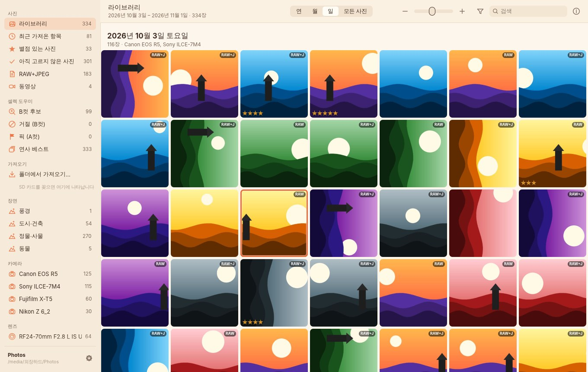

</div>

---

## 목차

1. [이런 분께 필요합니다](#이런-분께-필요합니다)
2. [한눈에 보는 사용 흐름](#한눈에-보는-사용-흐름)
3. [설치](#설치)
4. [처음 사용하기](#처음-사용하기)
5. [셀렉: 별점으로 고르기](#셀렉-별점으로-고르기)
6. [B컷 자동 찾기 — 셀렉 도우미](#b컷-자동-찾기--셀렉-도우미)
7. [작품 · 테마: 사진집 · 전시 준비](#작품--테마-사진집--전시-준비)
8. [찾기: 필터 · 검색 · 태그](#찾기-필터--검색--태그)
9. [RAW + JPEG — "어느 게 원본이지?"](#raw--jpeg--어느-게-원본이지)
10. [다른 프로그램과 함께 쓰기](#다른-프로그램과-함께-쓰기)
11. [단축키](#단축키)
12. [설정](#설정)
13. [내 사진은 안전한가요?](#내-사진은-안전한가요)
14. [지원 형식](#지원-형식)
15. [자주 묻는 질문 · 문제 해결](#자주-묻는-질문--문제-해결)
16. [성능](#성능)
17. [명령줄 도구 `photoorg`](#명령줄-도구-photoorg)
18. [개발자 안내](#개발자-안내)
19. [알려진 제한](#알려진-제한)

---

## 이런 분께 필요합니다

| 늘 겪던 일 | Photo Organize 에서는 |
|---|---|
| SD 카드를 외장 하드에 통째로 복사해 두고, 정리는 "나중에"… | 카드를 꽂으면 가져오기 화면이 뜨고, **복사하는 동시에 날짜별 폴더로 정리**됩니다. |
| 같은 카드를 또 복사해서 중복 파일이 쌓인다 | 이미 가져온 사진은 **자동으로 건너뜁니다.** 카드 화면에 `가져옴` 으로 표시돼요. |
| `IMG_0001.CR3` 와 `IMG_0001.JPG` 가 따로 놀아서 뭐가 원본인지 헷갈린다 | 둘은 **사진 한 장**으로 묶이고, 어떤 파일이 **RAW 원본**이고 어떤 게 **카메라 JPEG** 인지 바로 보입니다. |
| 셀렉하려면 무거운 편집 프로그램을 열어야 한다 | 가볍게 열어서 **F1~F5** 만 누르면 됩니다. 별점은 Lightroom 등에서도 그대로 보여요. |
| 수백 장 중 흔들리고, 핀 나가고, 눈 감은 사진을 일일이 걸러내기가 고역이다 | **셀렉 도우미**가 B컷 후보를 먼저 골라 이유와 함께 보여 줍니다. 내가 `X`(거절) · `P`(픽)로 고를수록 **내 기준을 장면별로 학습**합니다. |
| 작품 주제를 정해 두고도, 고른 사진을 테마별로 나누려면 폴더를 일일이 만들어 복사해야 한다 | **작품 · 테마**를 만들고 별점 준 사진에 **⇧1~⇧9** 로 테마를 붙입니다. **작품 폴더로 모으기** 한 번이면 `작품/바다 사진집/새벽/` 처럼 모여서 라이트룸에서 폴더째 편집할 수 있습니다. |
| "그때 그 85mm 로 찍은 사진" 을 찾기 어렵다 | **카메라 · 렌즈 · ISO · mm · f · 셔터 · 별점 · 날짜**로 즉시 필터링됩니다. |
| 정리해 둬도 나중에 데이터로 쓰기 어렵다 | EXIF 로 **자동 태그**가 붙고, 카탈로그를 **CSV** 로 내보낼 수 있습니다. |

---

## 한눈에 보는 사용 흐름

```
① 앱을 연다   →   ② SD 카드를 꽂는다   →   ③ [새 항목 모두 가져오기]   →   ④ F1~F5 로 셀렉
```

**② 카드를 꽂으면 가져오기 화면이 자동으로 열립니다.** 카드 속 사진이 날짜별로 보이고, 새 사진 수 · 용량 · RAW+JPEG 쌍 수 · 촬영 기간 · 카메라가 요약됩니다.

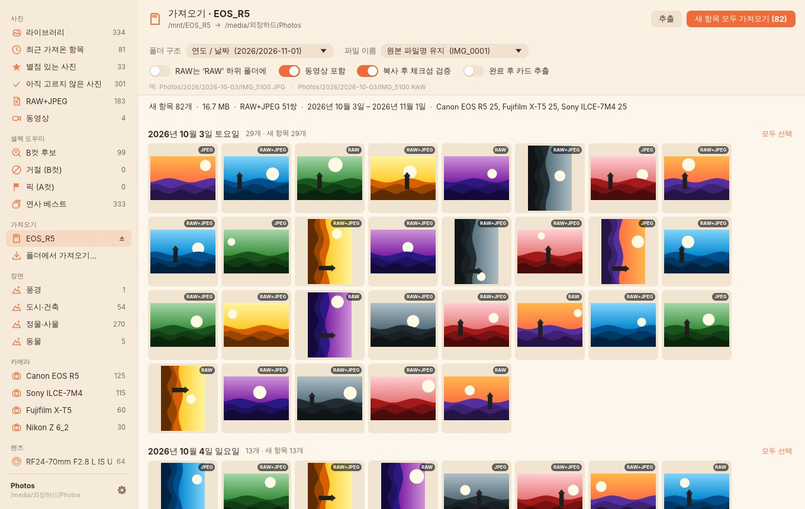

**③ 가져오기를 누르면** 복사 · 체크섬 검증 · 폴더 정리 · EXIF 태그 생성 · 썸네일 만들기가 **한 번에** 진행되고, 가져온 사진은 그 즉시 라이브러리에 나타납니다. 진행 중에도 다른 사진을 둘러볼 수 있어요.

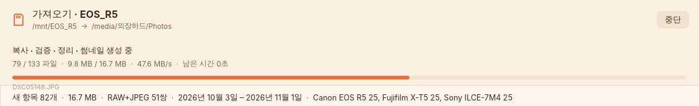

**④ 사진을 크게 보며 F1~F5 로 별점을 매깁니다.** `Z` 또는 클릭으로 100% 확대해 초점을 확인하고, ← → 로 넘깁니다.

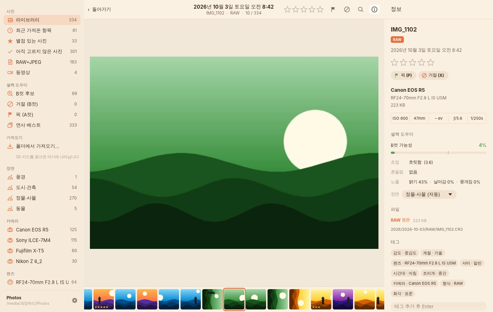

---

## 설치

### macOS (맥북) — 권장

Apple Silicon(M1·M2·M3·M4)과 Intel 맥 모두에서 실행되는 **유니버설 앱** 하나로 제공됩니다. macOS 11 이상.

1. **[Releases](https://github.com/MJ-best/exif-photo-organize/releases/latest)** 에서 `photo-organize-macos-universal.dmg` 를 내려받습니다.
2. *(최신 개발 버전을 원하면)* [Actions → build](https://github.com/MJ-best/exif-photo-organize/actions/workflows/build.yml) 에서 가장 최근의 초록색(✓) 실행 → **Artifacts** 의 `photo-organize-macos-universal` 을 받아 압축을 풉니다. *(GitHub 로그인 필요)*
3. `.dmg` 를 열고 **Photo Organize** 를 **Applications** 폴더로 끌어 놓습니다.
4. **처음 한 번은 직접 허용해야 합니다.** 앱을 열면 *"Apple은 'Photo Organize'에 Mac에 손상을 입히거나 개인정보를 침해할 수 있는 **악성 코드가 없음을 확인할 수 없습니다**"* 라는 창이 뜹니다.
   - **완료**를 누릅니다 (*휴지통으로 이동* 아님).
   - **시스템 설정 → 개인정보 보호 및 보안** 을 열고 맨 아래 **보안** 항목의 *"'Photo Organize'이(가) Mac을 보호하기 위해 차단되었습니다"* 옆 **그래도 열기** → 암호(또는 Touch ID) → 다시 뜨는 창에서 **그래도 열기**.
   - 한 번만 하면 다음부터는 그냥 열립니다. (macOS 14 이하는 Finder 에서 **우클릭 → 열기 → 열기** 로도 됩니다. macOS 15 부터는 우클릭으로는 열리지 않습니다.)
5. SD 카드나 외장 하드에 처음 접근할 때 *"이동식 볼륨의 파일에 접근하려고 합니다"* 창이 뜨면 **허용**을 누릅니다.

> **왜 "악성 코드" 경고가 나오나요?** 실제로 무엇이 발견된 게 아니라, Apple 의 유료 개발자 인증서로 서명하고 Apple 의 **공증(notarization)** 을 받지 않은 앱이면 모두 나오는 문구입니다. 이 앱은 소스가 모두 공개되어 있고, GitHub Actions 에서 이 저장소의 코드로 빌드됩니다. 공증을 켜는 방법은 [macOS 공증](#macos-공증-경고-없이-열리게-하기) 에 있습니다.

**터미널로 설치하기 (경고 없이)** — 브라우저로 받은 파일에만 붙는 "인터넷에서 받음" 표시가 `curl` 로 받으면 붙지 않아, 위의 허용 과정 없이 바로 열립니다. *그래도 열기* 를 누르는 것과 같은 효과입니다.

```bash
curl -fL https://github.com/MJ-best/exif-photo-organize/releases/latest/download/photo-organize-macos-universal.zip -o /tmp/photo-organize.zip \
  && rm -rf "/Applications/Photo Organize.app" \
  && ditto -x -k /tmp/photo-organize.zip /Applications \
  && open "/Applications/Photo Organize.app"
```

이미 브라우저로 받아 *Applications* 에 넣었다면 이것만 실행해도 됩니다: `xattr -dr com.apple.quarantine "/Applications/Photo Organize.app"`

> 새 버전 릴리스: `Cargo.toml` 의 `version` 을 올리고 `docs/releases/v<버전>.md` 에 릴리스 노트를 써서 main 에 머지하면, CI 가 빌드한 뒤 태그와 [Releases](https://github.com/MJ-best/exif-photo-organize/releases) 를 자동으로 만듭니다. 태그(`v*`)를 직접 푸시하거나 *Actions → build → Run workflow* 에서 `release_tag` 를 입력해도 됩니다.

### Windows · Linux

[Releases](https://github.com/MJ-best/exif-photo-organize/releases/latest) 의 `photo-organize-windows-x86_64.zip` / `photo-organize-linux-x86_64.tar.gz` 를 받아 `photo-organize` 를 실행합니다.
Windows 에서 *"Windows의 PC 보호"* 창이 뜨면 **추가 정보 → 실행** 을 누르세요. (코드 서명 인증서가 없는 새 프로그램이라 나오는 SmartScreen 경고입니다.)
Microsoft Defender 가 압축 파일이나 `photo-organize.exe` 를 *위협* 으로 격리했다면 서명 없는 새 실행 파일에 대한 오탐입니다: **Windows 보안 → 바이러스 및 위협 방지 → 보호 기록** 에서 해당 항목을 **허용** 하고 다시 압축을 푸세요.
Linux 는 X11/Wayland, Vulkan 또는 OpenGL 드라이버(Mesa), `libxkbcommon-x11` 이 필요합니다.

### 직접 빌드

[Rust](https://rustup.rs) 1.95 이상이 필요합니다.

```bash
git clone https://github.com/MJ-best/exif-photo-organize.git
cd exif-photo-organize
cargo run --release -p photoorg-app          # 앱 실행

# macOS .app 만들기
cargo build --release -p photoorg-app
./scripts/macos-bundle.sh target/release/photo-organize dist   # → dist/Photo Organize.app
```

---

## 처음 사용하기

### 1. 라이브러리 폴더 정하기

처음 실행하면 사진을 보관할 **라이브러리 폴더**를 고릅니다. 외장 하드 안의 폴더를 권장합니다 (예: `/Volumes/외장하드/Photos`). 없는 폴더를 고르면 새로 만듭니다.

- 라이브러리는 **평범한 폴더**입니다. 정리된 사진은 날짜별 하위 폴더에 그대로 들어가므로 Finder 나 다른 앱에서도 바로 열 수 있습니다.
- 카탈로그(별점·태그·검색용 정보)와 썸네일은 그 폴더 안의 숨김 폴더 `.photo-organize/` 에 저장됩니다.
  그래서 **외장 하드를 다른 컴퓨터에 꽂아도** 정리 상태가 그대로 따라갑니다.
- 외장 하드를 뺀 채로 앱을 열면 *"라이브러리를 찾을 수 없습니다"* 가 표시되고, **하드를 다시 꽂으면 자동으로 열립니다.**

### 2. SD 카드 가져오기

카드를 꽂으면 사이드바 **가져오기** 아래에 카드 이름이 나타나고 가져오기 화면이 열립니다. *(설정에서 자동 열기를 끌 수 있습니다.)*
카드가 아닌 일반 폴더(예: 예전에 통째로 복사해 둔 폴더)는 **폴더에서 가져오기…** 로 같은 방식으로 정리할 수 있습니다.

| 가져오기 옵션 | 설명 |
|---|---|
| **폴더 구조** | `연도/날짜` (2026/2026-11-01, 기본) · `연/월/일` · `연도/날짜/카메라` · `카메라/연도/날짜` · `연도/월` |
| **파일 이름** | 원본 이름 유지 (기본) · `20261101_142530_IMG_0001` · `2026-11-01_IMG_0001` |
| **RAW 는 'RAW' 하위 폴더에** | 켜면 RAW 파일만 `…/2026-11-01/RAW/` 로 따로 모읍니다. 앱 안에서는 여전히 JPEG 와 한 장으로 묶입니다. |
| **동영상 포함** | MP4·MOV 등도 날짜별로 함께 정리합니다. |
| **복사 후 체크섬 검증** | 디스크에 기록을 확정(fsync)한 뒤 다시 읽어 체크섬을 비교합니다. 권장. |
| **완료 후 카드 추출** | 가져오기가 문제없이 끝나면 카드를 안전하게 꺼냅니다. |

일부만 가져오려면 사진을 클릭해 고른 뒤 **선택 항목 가져오기**를 누르세요. 날짜 옆 **모두 선택**으로 하루치를 한 번에 고를 수 있습니다.

### 3. 이렇게 정리됩니다

```
외장하드/Photos/                     ← 라이브러리 폴더
├── 2026/
│   ├── 2026-10-03/
│   │   ├── IMG_1101.JPG             ← 카메라 JPEG
│   │   ├── IMG_1102.JPG
│   │   └── RAW/                     ← (옵션) RAW 하위 폴더
│   │       ├── IMG_1101.CR3         ← RAW 원본
│   │       └── IMG_1101.xmp         ← 별점·태그 (Lightroom 호환)
│   └── 2026-10-04/
│       └── …
└── .photo-organize/                 ← 숨김: 카탈로그와 썸네일
    ├── catalog.db
    └── thumbs.db
```

- 촬영 날짜는 EXIF 의 *DateTimeOriginal* 을 씁니다. EXIF 가 없는 파일(동영상 등)은 파일 수정 시간을 씁니다.
- 카메라 파일 번호가 한 바퀴 돌아 같은 이름이 이미 있으면 `IMG_0001_1.JPG` 처럼 바꾸며, **RAW 와 JPEG 는 함께** 바꿔 쌍이 깨지지 않습니다.

---

## 셀렉: 별점으로 고르기

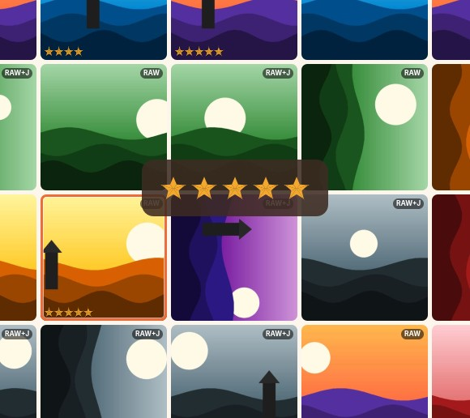

| 키 | 동작 |
|---|---|
| **F1 ~ F5** (또는 1~5) | 별점 1~5개 |
| **0** (또는 F6) | 별점 지우기 |
| **Space / Enter** | 크게 보기 ↔ 돌아가기 |
| **← →** | 이전 / 다음 사진 |
| **Z** 또는 클릭 | 100% 확대 (드래그로 이동) |

- 그리드에서 여러 장을 선택(⌘/Ctrl·Shift 클릭, Shift+방향키)한 뒤 누르면 **한 번에** 적용됩니다.
- 별점 · 픽 · 거절을 하면 사진 아래 띠에 ★ 표시가 작게 잠깐 떠서 확인할 수 있습니다 (사진을 가리지 않음).
- 설정의 **"별점을 매기면 다음 사진으로 이동"** 을 켜면 키 한 번에 다음 사진으로 넘어가 셀렉이 훨씬 빨라집니다.
- 카메라에서 미리 매긴 별점(EXIF·XMP)도 가져올 때 그대로 읽어 옵니다.
- 사이드바 **아직 고르지 않은 사진**은 별점도, 픽 · 거절도 없는 사진입니다. 별점을 주거나 `P` · `X` 를 누르면 바로 목록에서 빠집니다.

<br clear="right">

**추천 셀렉 루틴**

1. 가져오기가 끝나면 사이드바의 **최근 가져온 항목**을 엽니다.
2. 첫 사진에서 **Space** 로 크게 보고, ← → 로 넘기며 **F1~F5** 로 1차 셀렉합니다. 애매하면 **Z** 로 초점을 확인하세요.
   먼저 사이드바 **셀렉 도우미 → B컷 후보**에서 흔들리거나 눈 감은 컷을 `X` 로 걸러 두면 훨씬 빨라집니다 ([아래](#b컷-자동-찾기--셀렉-도우미)).
3. 필터 바에서 **별점 → ★3개 이상**으로 좁힌 뒤 한 번 더 추립니다.
4. 남은 사진을 **⌘/Ctrl+A** 로 모두 선택하고, 정보 패널의 **내보내기** 에서 보정용은 **원본 전체**, 공유용은 **JPEG만** 또는 **작게…** 로 폴더에 내보냅니다.
5. 사진집 · 전시처럼 주제가 있는 작업이면 고른 사진에 **작품 테마**를 붙여 테마별로 나눕니다 ([아래](#작품--테마-사진집--전시-준비)).

---

## B컷 자동 찾기 — 셀렉 도우미

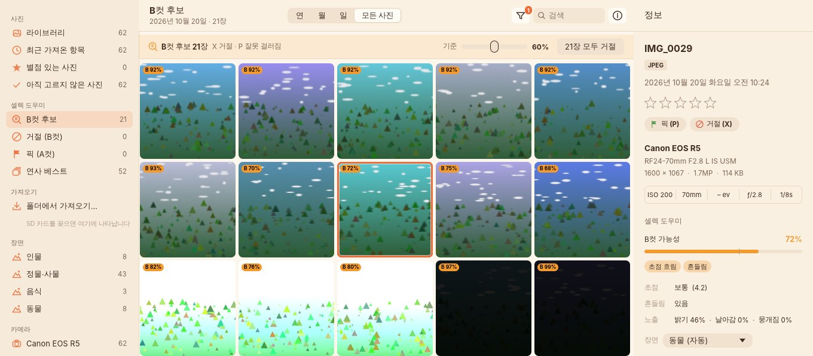

가져온 사진은 백그라운드에서 자동으로 분석되고, **B컷일 가능성(%)과 이유**가 붙습니다. 사이드바 **셀렉 도우미 → B컷 후보**를 열면 아직 고르지 않은 사진(별점 · 픽 · 거절 없음) 중 기준(기본 60%) 이상인 것만 모여 있습니다. 반대로 **A컷 후보**에는 가장 잘 나온 사진이 모입니다 ([아래](#a컷-후보--가장-잘-나온-사진)). 사진은 **절대 지우지 않습니다** — 표시만 합니다.

후보 바에는 지금 **기본 기준**으로 고르는지, **내 기준으로 학습됨 (A n · B n · 정확도 n%)** 인지가 표시됩니다. 누르면 **내 셀렉 정확도**가 열립니다 ([아래](#내-셀렉-정확도)).

### 무엇을 찾나요

| 이유 | 어떻게 판단하나 |
|---|---|
| **초점 흐림** | 화면을 8×8 칸으로 나눠 가장 선명한 부분의 디테일(라플라시안 분산)을 잽니다. 배경이 날아간 인물·접사도 *어딘가 한 곳*이 선명하면 통과합니다. 같은 장면 사진들끼리도 비교합니다. |
| **흔들림** | 디테일이 한 방향으로만 번져 있는지(구조 텐서 방향성)를 봅니다. 줄무늬·건물처럼 원래 한 방향인 피사체와 구분하려고 여러 칸이 *같은 방향*으로 번졌을 때만 흔들림으로 봅니다. 셔터 속도 × 초점거리(손떨림 한계)도 참고합니다. |
| **얼굴 초점 빗나감** | 얼굴을 찾아(YuNet) 얼굴 안쪽이 사진의 가장 선명한 곳보다 확실히 흐리면 — 핀이 배경에 간 경우 |
| **눈 감음 의심** | 얼굴의 눈 위치에서 눈꺼풀/눈동자의 세로 윤곽이 남아 있는지 봅니다. 얼굴이 너무 작으면(눈 사이 24px 미만) 판단하지 않습니다. |
| **노출 과다 · 부족** | 하얗게 날아간 면적, 검게 뭉개진 면적, 평균 밝기. 노을 · 꽃처럼 한 색이 진한 것은 날아간 것으로 보지 않습니다. 하늘이 조금 날아간 정도나 야경의 어두움은 정상으로 봅니다. 어두운 사진은 밝기를 맞춘 뒤 초점을 재서, *어둡다고 흐린 사진으로 오해하지 않습니다.* |
| **연사 중 덜 선명** | 같은 카메라로 3초 안에 찍은 비슷한 장면(perceptual hash)을 한 묶음으로 보고, 그 안에서 순위를 매깁니다. 썸네일의 `1/4` 배지가 묶음 안 순위(파란색 = 베스트)입니다. |
| 고감도 노이즈 | 보조 신호 (ISO 가 아주 높을 때 약간 가산) |
| **내가 거절한 사진과 비슷** | 내가 거절해 온 사진과 *무엇을 · 어떻게 찍었는지* 가 닮았을 때. 판정이 쌓여야 나타납니다 ([취향 학습](#취향까지-배웁니다--어떤-사진을-남기는지)) |

### 쓰는 법

| 키 · 버튼 | 동작 |
|---|---|
| **X** | 거절 — B컷 (다시 누르면 해제) |
| **P** | 픽 — A컷. 잘못 걸러진 후보에 누르면 *"이건 B컷 아님"* 으로 학습됩니다 |
| **U** | 픽/거절 해제 |
| B컷 후보 바의 **기준** 슬라이더 | 30–90%. 낮추면 더 많이 걸러내고, 높이면 확실한 것만 |
| **n장 모두 거절** | 지금 보이는 후보를 한 번에 거절 (언제든 `U` 로 되돌릴 수 있음) |
| 사이드바 **연사 베스트** | 연사 묶음마다 가장 좋은 한 장 + 단독 사진만 보기 |
| 사이드바 **거절 · 픽**, 필터 바 **셀렉 · 장면** | 고른 결과만 모아 보기 |

정보 패널(⌘/Ctrl+I)에는 B컷 가능성 막대, 이유, 측정값(초점 · 흔들림 · 노출 · 얼굴 수 · 눈 · 연사 순위), **장면**이 표시됩니다.

### 따로 라벨링할 필요가 없습니다 — 평소 셀렉이 곧 학습 데이터

처음에는 위의 객관적 기준만으로 동작하고, 평소처럼 고르기만 하면 그 결과가 학습 데이터가 됩니다.

- **A컷으로 학습**: `P`(픽), 그리고 ★3개 이상 (설정에서 ★2+ / ★4+ / 픽만 으로 변경)
- **B컷으로 학습**: `X`(거절), 그리고 ★1개 (설정에서 끌 수 있음)
- A·B 가 각각 **6장 이상** 모이면 라이브러리 전체에서 *내 기준*을 학습하고, 한 장면에서 각각 **10장 이상** 모이면 **그 장면만의 기준**을 따로 학습합니다.
  예를 들어 인물 사진에서는 눈 감음·얼굴 초점에 엄격하고, 풍경에서는 살짝 흔들린 건 괜찮게 여기는 식의 차이가 반영됩니다.
- 고를 때마다(1~2초 뒤) 백그라운드에서 다시 학습해 후보 목록이 바로 바뀝니다. 사진을 다시 분석하지 않으므로 수만 장도 순식간입니다.
- 학습은 데이터가 적어도 엉뚱해지지 않도록 *기본 기준에서 조금씩 벗어나는* 방식(규제된 로지스틱 회귀)이고, 장면별 기준은 전체 기준에서 출발합니다. 설정 → 셀렉 도우미에서 장면별 A/B 수, 사용 중인 기준, 교차검증 정확도를 볼 수 있습니다.
- 학습은 **어떤 사진이 B컷인지**(순서)를 내 기준으로 바꾸고, **몇 장이 B컷인지**(비율)는 기본 기준을 따르되 내 판정으로 보정합니다 — 기본 기준이 B컷이라 한 사진을 내가 많이 살리면 후보가 줄고, 괜찮다던 사진을 많이 거절하면 늘어납니다. 보통 가장 심한 B컷부터 거절하게 되는데, 이것만 배우면 *"아주 심하게 흐린 것만 B컷"* 으로 잘못 배워 후보가 한꺼번에 사라지던 문제를 이렇게 막습니다.

### 취향까지 배웁니다 — 어떤 사진을 남기는지

초점 · 노출만으로는 B컷을 다 설명할 수 없습니다. 선명해도 늘 지우는 컷(하객 뒷모습, 이동 중 찍힌 바닥, 매번 찍는 입간판)이 있고, 조금 흔들려도 꼭 남기는 컷이 있습니다. 그래서 *무엇을 · 어떻게 찍었는지* 도 배웁니다.

- 분석할 때 장면 인식 신경망(MobileNetV2)이 본 **사진 내용의 요약**(숫자 128개)을 함께 저장합니다. 피사체 · 구도 · 색과 분위기가 비슷한 사진은 이 숫자도 비슷합니다.
- 학습할 때 사진마다 **내가 거절한 사진 중 가장 닮은 5장**, **내가 남긴 사진(픽 · ★3+) 중 가장 닮은 5장**과 얼마나 닮았는지를 재서, 초점 · 흔들림 · 눈 같은 기준과 함께 학습합니다. 거절해 온 종류와 닮은 사진은 B컷 쪽으로(이유: *내가 거절한 사진과 비슷*), 남겨 온 종류와 닮은 사진은 A컷 후보 쪽으로 갑니다.
- **같은 순간끼리는 비교하지 않습니다** — 같은 연사나 같은 카메라로 1분 안에 찍은 사진은 같은 장면이라 닮은 게 당연하고, 그 안에서 고르는 건 연사 비교가 맡습니다.
- 판정이 없으면 아무 영향이 없고(기본 기준에서 0으로 출발), 판정이 쌓일수록 내 셀렉에서 실제로 맞아떨어지는 만큼만 무게가 붙습니다. 내 판정과 상관없는 닮음은 학습이 무시합니다.
- 계산은 기기 안에서만 합니다. 2만 장 · 판정 3천 장도 다시 학습하는 데 0.5초 안팎(4코어)입니다.

> 이 기능이 처음 들어간 버전으로 업데이트하면, 모든 사진을 **한 번 다시 분석**합니다(최근 사진부터, 백그라운드). 그동안에도 셀렉 도우미는 이전 분석으로 계속 동작하고, 1,000장마다 새 분석이 반영됩니다. 고르는 대로 바로 학습하는 것도 그대로입니다.

### 내 셀렉 정확도

학습이 정말 내 기준을 따라가는지 숫자로 확인합니다. 후보 바의 학습 상태나 설정 → 셀렉 도우미의 **내 셀렉 정확도…** 를 누르세요.

- 내가 판정한 사진(픽 · 거절 · 별점)을 5묶음으로 나눠, 한 묶음씩 가린 채 나머지로 학습하고 가린 사진을 맞혀 봅니다. **학습에 쓰지 않은 사진으로 잰 값**이고, 기본 기준(학습 전)과 나란히 보여 줍니다.
- **A컷 · B컷 구분 정확도** — B컷 하나와 A컷 하나를 무작위로 골랐을 때 B컷 쪽을 더 B컷답다고 본 비율 (50% = 찍기, 100% = 완벽)
- 지금 기준(%)에서: 거절할 사진을 미리 잡아낸 비율, B컷 후보가 맞은 비율, **A컷을 B컷 후보로 잘못 올린 비율**(낮을수록 좋음), A컷 후보 적중, 후보 목록 크기
- 장면별 정확도와, 판정이 쌓이며 바뀐 정확도 그래프 (내 기준 vs 기본 기준)
- A컷 · B컷을 각각 5장 이상 고르면 재고, 판정이 늘어나거나 기준을 바꾸면 뒤에서 다시 잽니다 (수만 장도 1초 안팎).
- 후보 목록에서만 판정하면 쉬운 사진 위주로 재게 되므로, 라이브러리 전체에서 고르게 판정할수록 숫자가 정확해집니다.

같은 값을 명령줄에서도 볼 수 있습니다: `photoorg cull-eval <라이브러리> [--json]`

### A컷 후보 — 가장 잘 나온 사진

사이드바 **셀렉 도우미 → A컷 후보**에는 아직 고르지 않은 사진 중 **가장 잘 나온 상위 15%**(바의 **기준**으로 5–50% 조절)가 모입니다.

- B컷 가능성이 가장 낮은 순서 — 초점 · 흔들림 · 노출 · 얼굴 초점 · 눈 · 연사 비교와, 내가 고른 A컷(픽 · ★3+)과 *무엇을 · 어떻게 찍었는지* 까지 닮은 정도로 정합니다 ([취향 학습](#취향까지-배웁니다--어떤-사진을-남기는지)).
- 연사 묶음은 **베스트 한 장만** 후보가 됩니다.
- `P` 로 픽하거나 별점을 주면 목록에서 빠지고, 아니라면 `X` (학습에 반영). **n장 모두 픽** 으로 한 번에 고를 수도 있습니다 (`U` 로 되돌리기).
- 정보 패널에 *"가장 잘 나온 사진 상위 n%"* 가 함께 표시됩니다.
- 내가 남겨 온 *종류*의 사진은 앞으로 오지만, 표정 · 순간 · 구도의 좋고 나쁨을 직접 판단하지는 못합니다. **잘 찍힌 사진을 먼저 보여 주는 출발점**으로 쓰세요.

**장면**은 얼굴 크기와 이미지 분류(MobileNetV2)로 정합니다: 인물 · 풍경 · 도시·건축 · 정물·사물 · 음식 · 동물 · 기타. 잘못 분류됐으면 정보 패널의 **장면** 메뉴에서 바로잡으세요 — 그 사진은 바로잡은 장면의 기준으로 학습·판단됩니다.

### 다른 프로그램과의 호환

- **거절**은 XMP 사이드카에 `xmp:Rating="-1"` 로 기록됩니다. Lightroom 이 *거부(Rejected)* 로 쓰는 것과 같은 규칙이라 Lightroom · Bridge 에서도 거부로 보입니다. 반대로 다른 앱에서 거부한 사진은 가져올 때 거절로 읽힙니다.
- **픽**은 표준 XMP 필드가 없어 이 앱의 카탈로그에만 저장됩니다.
- 분석 결과와 학습된 기준은 라이브러리의 `.photo-organize/catalog.db` 에 저장됩니다. 인터넷으로 아무것도 보내지 않으며, 모델은 앱 안에 들어 있습니다.

### 얼마나 정확한가요?

일부러 망친 사진을 섞은 테스트 카드(정상 41장 + 초점 흐림 · 흔들림 · 과다/부족 노출 · 연사 중 흐린 컷 · 눈 감음 · 얼굴 흐림 21장)에서 기본 기준(60%)으로 **B컷 21장을 모두 찾고, 정상 사진은 하나도 후보로 올리지 않았습니다.** 다만 이 사진들은 합성 · 가공한 것이라 실제 촬영본에서는 결과가 다를 수 있습니다. 특히:

- **눈 감음**은 얼굴 랜드마크 주변의 윤곽으로 추정하는 방식이라 선글라스 · 앞머리 · 옆얼굴 · 웃느라 눈이 가늘어진 경우 틀릴 수 있습니다. 합성한 감은 눈으로만 검증했습니다.
- 의도한 흔들림(패닝) · 소프트 포커스 · 하이키/로우키, 그리고 안개 · 맑은 하늘처럼 **디테일이 거의 없는 사진**은 B컷처럼 보일 수 있습니다. `P` 로 몇 번 알려 주면 그 장면의 기준이 맞춰집니다.

그래서 이 기능은 **지우는 기능이 아니라 먼저 보여 주는 기능**입니다. 마지막 결정은 항상 사용자가 합니다.

---

## 작품 · 테마: 사진집 · 전시 준비

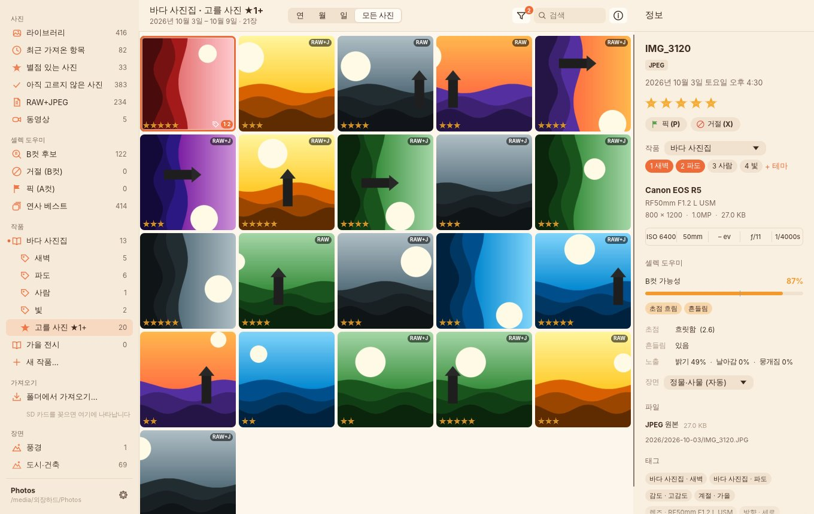

인물 · 풍경 같은 자동 분류와 별개로, **내가 정한 작품 주제와 테마**로 사진을 나눕니다. 예를 들어 작품 *바다 사진집* 에 테마 *새벽 · 파도 · 사람 · 빛* 을 만들고, 별점을 준(예비 셀렉) 사진을 테마로 보내 두면 사진집을 엮거나 전시를 준비할 때 테마별로 바로 꺼내 쓸 수 있습니다.

**쓰는 법**

1. 사이드바 **작품 → 새 작품…** 에서 작품 이름과 테마를 적습니다 (한 줄에 하나, 또는 쉼표로). 테마에는 순서대로 **⇧1 ~ ⇧9** 단축키가 붙습니다.
2. **별점 있는 사진**(또는 **픽**)을 열면 사진 위에 **테마로 보내기** 바가 보입니다: `[바다 사진집 ▾] 테마로 보내기 [1 새벽] [2 파도] …`
3. 사진을 고르고(여러 장은 ⌘/Ctrl · Shift + 클릭) 테마 버튼을 누르거나 **⇧1 ~ ⇧9** 를 누르면 그 테마로 보내집니다. 사진 아래 띠에 *"바다 사진집 › 새벽에 보냄"* 이 잠깐 뜨고, 다시 누르면 뺍니다.
   - 보낸 사진은 썸네일 오른쪽 아래에 **테마 이름**(`새벽`, `새벽 · 파도`)이 붙어서 한눈에 구분됩니다.
   - 한 사진을 **여러 테마**로 보낼 수 있습니다. 크게 보기 · 정보 패널의 테마 칩에서도 똑같이 됩니다.
   - 바 오른쪽 **보낸 사진 숨기기**를 켜면 아직 보내지 않은 사진만 남습니다. 보낸 사진은 그 자리에 있다가 다음 사진으로 넘어가면 빠지므로, 한 사진에 테마를 몇 개 붙여도 됩니다.
   - 작품이 여럿이면 바의 메뉴에서 바꿉니다 (⇧1~9 와 버튼은 그 작품의 테마).
4. 바의 **보낸 사진 n장 ›** 이나 사이드바의 **작품 · 테마**를 누르면 보낸 사진만 모아 보면서 다시 추릴 수 있습니다. 옆의 숫자는 사진 수입니다.
5. 편집할 때는 **작품 폴더로 모으기**로 사진을 한 폴더에 모아 라이트룸 등에서 엽니다 ([아래](#작품-폴더-라이트룸-등에서-편집하기)).
6. 공유 · 인쇄소용 파일은 작품을 우클릭 → **테마별 폴더로 내보내기…** 로 만듭니다. `새벽/` `파도/` … 처럼 테마 이름의 폴더에 나눠 담기고, 형식(JPEG만 · 작게 · 원본 전체)과 ZIP 묶기는 [보통 내보내기](#다른-프로그램과-함께-쓰기)와 같습니다. 두 테마에 든 사진은 두 폴더에 모두 들어갑니다.

| 할 일 | 방법 |
|---|---|
| 작업할 작품 바꾸기 | 사이드바에서 작품을 누르거나 정보 패널의 **작품** 메뉴 (⇧1~9 와 칩은 이 작품의 테마) |
| 테마 추가 · 이름 바꾸기 | 작품 우클릭 → **테마 추가…**, 정보 패널의 **+ 테마** / 테마 우클릭 → **이름 바꾸기…** |
| 테마 순서 (단축키 번호) | 테마 우클릭 → **위로 · 아래로** |
| 지우기 | 작품 · 테마 우클릭 → **삭제…** — 사진에서 그 테마만 빠지고 사진 · 별점은 그대로입니다 |

- 테마는 태그의 한 종류라 **검색 · 필터 바의 태그 · CSV** 에 `바다 사진집:새벽` 으로 나오고, XMP 사이드카에는 Lightroom 계층 키워드 `바다 사진집|새벽` 으로 기록됩니다. Lightroom 에서도 *바다 사진집 ▸ 새벽* 키워드로 모아 볼 수 있습니다. 이름을 바꾸면 사진의 XMP 키워드도 함께 바뀝니다.
- 작품 · 테마는 라이브러리 안의 카탈로그에 저장되므로 외장 하드를 다른 컴퓨터에 연결해도 그대로입니다.

### 작품 폴더: 라이트룸 등에서 편집하기

```
① 셀렉 (별점 · 픽)  →  ② 별점 있는 사진에서 테마로 보내기 (⇧1~9)  →  ③ 작품 폴더로 모으기  →  ④ 라이트룸에서 폴더째 가져와 편집
```

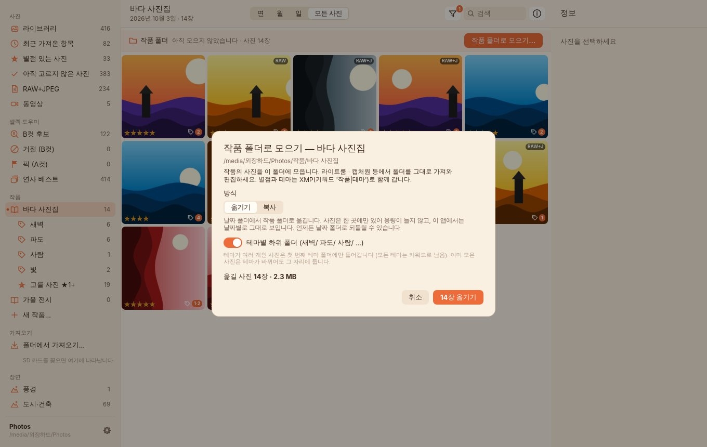

작품을 누르면 사진 위에 **작품 폴더** 바가 보입니다. **작품 폴더로 모으기…** 를 누르면 작품의 사진이 라이브러리 안의 한 폴더에 모입니다.

```
외장하드/Photos/
├── 2026/2026-10-03/…          ← 날짜 폴더 (가져온 그대로)
└── 작품/
    └── 바다 사진집/
        ├── 새벽/  IMG_0001.CR3 · IMG_0001.JPG · IMG_0001.xmp …
        └── 파도/  IMG_0002.CR3 …
```

| 방식 | 하는 일 |
|---|---|
| **옮기기** (기본) | 날짜 폴더에서 작품 폴더로 **옮깁니다.** 사진은 한 곳에만 있어 용량이 늘지 않고, 이 앱에서는 날짜별로 그대로 보이고 별점 · 테마도 그대로입니다. 원래 자리를 기억하므로 작품 우클릭 → **날짜 폴더로 되돌리기** 로 언제든 되돌릴 수 있습니다. |
| **복사** | 날짜 폴더의 원본은 보관용으로 그대로 두고 작품 폴더에 **복사본**을 만듭니다 (그만큼 용량이 더 듭니다). |

- RAW · JPEG · XMP 사이드카가 함께 가므로 라이트룸에서 폴더를 **추가(Add)** 로 가져오면 별점과 테마 키워드(`바다 사진집|새벽`)가 그대로 보입니다.
- **테마별 하위 폴더**(기본)를 켜면 `새벽/` `파도/` … 로 나뉩니다. 테마가 여러 개인 사진은 **첫 번째 테마 폴더에 한 번만** 들어가서, 편집할 때 같은 사진이 두 번 나오지 않습니다 (모든 테마는 키워드로 남음).
- **다시 누르면 새로 고른 사진만** 더합니다. 이미 모은 사진은 테마가 바뀌어도 그 자리에 둡니다 — 라이트룸에 가져온 뒤에 파일이 움직이면 라이트룸이 사진을 놓치기 때문입니다.
- 이름이 같은 사진(`IMG_0001` 이 두 카메라에)은 `IMG_0001_1` 처럼 RAW · JPEG · XMP 가 같은 이름으로 바뀝니다.
- 다른 작품 폴더로 이미 옮긴 사진은 옮기지 않고 **복사**합니다 (한 사진이 두 작품에 들어간 경우).
- 테마를 빼서 작품에서 빠진 사진이 폴더에 남아 있으면 바에 *"작품에서 빠진 n장"* 이 보이고, 누르면 날짜 폴더로 되돌립니다.
- 작품 · 테마 **이름을 바꾸면 폴더 이름도** 함께 바뀝니다. 라이트룸에 이미 가져왔다면 라이트룸에서 폴더 위치를 다시 지정하세요 (폴더 우클릭 → *누락된 폴더 찾기*).
- 작품을 지워도 작품 폴더의 파일은 남습니다. 옮긴 사진을 날짜 폴더로 돌리려면 지우기 전에 **날짜 폴더로 되돌리기**를 하세요.
- 옮기는 동안 진행 상황이 사이드바 아래에 보이고, 누르면 중지합니다 (그때까지 옮긴 사진은 그대로 둡니다). 한 사진의 파일(RAW · JPEG · XMP)은 함께 옮겨지고, 하나라도 실패하면 그 사진은 원래 자리로 돌아갑니다.

---

## 찾기: 필터 · 검색 · 태그

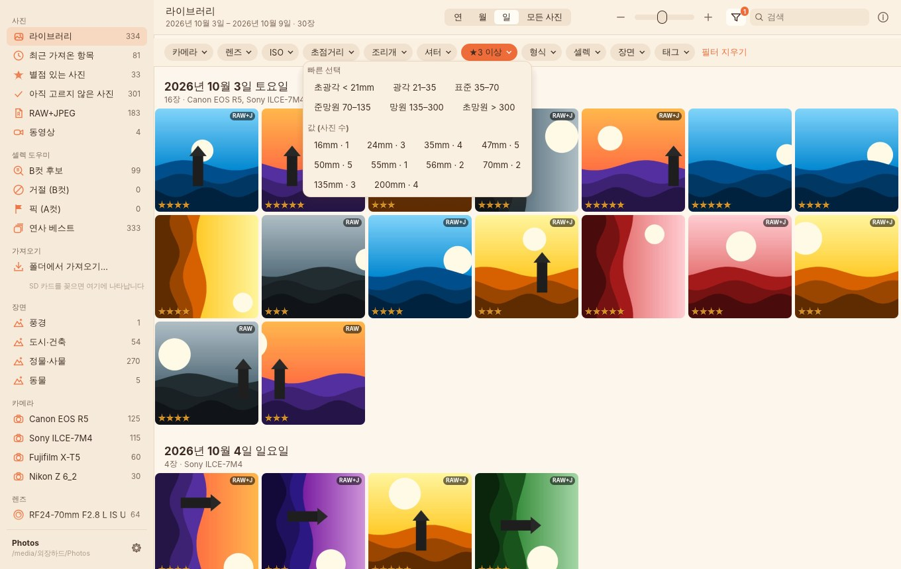

툴바의 깔때기 아이콘을 누르면 필터 바가 열립니다. 각 항목에는 **지금 조건에서 해당하는 사진 수**가 함께 표시돼서, 고르기 전에 결과를 미리 알 수 있습니다.

| 필터 | 고르는 방법 |
|---|---|
| **카메라 · 렌즈** | 여러 개 체크 (그중 하나라도 맞으면 표시) |
| **ISO** | 빠른 선택(≤400 · 400–1600 · 1600–6400 · ≥6400) 또는 실제 값 목록 |
| **초점거리** | 초광각 <21mm · 광각 21–35 · 표준 35–70 · 준망원 70–135 · 망원 135–300 · 초망원 >300, 또는 mm 값 |
| **조리개** | ≤ƒ/2 · ƒ/2–4 · ƒ/4–8 · ≥ƒ/8, 또는 ƒ 값 |
| **셔터** | 고속 ≤1/1000 · 1/1000–1/125 · 1/125–1/30 · 저속 1/30–1s · 장노출 ≥1s, 또는 실제 값 |
| **별점** | ★1개 이상 … ★5개, 별점 없음 |
| **형식** | RAW+JPEG · RAW 있음 · JPEG/HEIF만 · 사진 · 동영상 |
| **셀렉** | B컷 후보(기준 % 이상) · A컷 후보(상위 %) · 거절 · 픽 · 아직 안 고름 · 연사 베스트만 |
| **장면** | 인물 · 풍경 · 도시·건축 · 정물·사물 · 음식 · 동물 · 기타 (여러 개 선택) |
| **태그** | 자동 태그 + 직접 붙인 태그 (선택한 태그를 **모두** 가진 사진) |

- **검색창**(⌘/Ctrl+F)은 파일 이름 · 카메라 · 렌즈 · 태그를 함께 찾습니다.
- **날짜**는 상단의 **연 · 월 · 일 · 모든 사진** 으로 탐색합니다. 연도 카드 → 월 카드 → 그날의 사진으로 바로 내려갑니다.
- **사이드바**에서 자주 쓰는 범위를 한 번에 엽니다: 라이브러리 · 최근 가져온 항목 · 별점 있는 / 아직 고르지 않은 사진 · RAW+JPEG · 동영상 · **셀렉 도우미**(B컷 후보 · A컷 후보 · 거절 · 픽 · 연사 베스트) · **작품 · 테마** · **장면별** · **카메라별** · **렌즈별** · **가져오기 기록**(카드별).

### 자동 태그

가져올 때 EXIF 를 읽어 아래 태그를 자동으로 붙입니다. 필터 · 검색에 쓰이고, XMP 사이드카와 CSV 에도 들어가서 나중에 데이터로 활용할 수 있습니다.

| 분류 | 값 |
|---|---|
| 카메라 / 렌즈 | `카메라:Canon EOS R5`, `렌즈:RF24-70mm F2.8 L IS USM` |
| 화각 (35mm 환산) | 초광각 · 광각 · 표준 · 준망원 · 망원 · 초망원 |
| 감도 | 저감도(≤400) · 중감도(≤1600) · 고감도(≤6400) · 초고감도 |
| 조리개 | 개방(≤ƒ/2.8) · 중간 · 조임(≥ƒ/8) |
| 셔터 | 고속(≤1/1000) · 일반 · 저속(>1/30) · 장노출(≥1s) |
| 시간대 · 계절 | 새벽 · 아침 · 낮 · 저녁 · 밤 / 봄 · 여름 · 가을 · 겨울 |
| 방향 · 형식 | 가로 · 세로 · 정방형 / RAW+JPEG · RAW · JPEG · HEIF · 동영상 |
| 기타 | 플래시 · 위치정보 · 노출보정 ± |

정보 패널(⌘/Ctrl+I)에서 **직접 태그**를 추가하고 지울 수 있습니다. 여러 장을 선택하면 한 번에 붙습니다.

---

## RAW + JPEG — "어느 게 원본이지?"

- 같은 이름의 RAW 와 JPEG(`IMG_0001.CR3` + `IMG_0001.JPG`)는 **한 장의 사진**으로 다룹니다. 별점도 한 번만 매기면 됩니다.
- 썸네일 오른쪽 위 배지로 구성을 바로 알 수 있습니다: `RAW+J` · `RAW` · (배지 없음 = JPEG)
- **정보 패널**에 파일별 역할이 표시됩니다:
  - **RAW 원본** — 카메라가 기록한 센서 데이터
  - **JPEG (카메라 현상)** — 카메라가 RAW 로 만든 JPEG
  - **JPEG 원본** — RAW 없이 JPEG 로만 찍은 사진

  경로를 클릭하면 Finder/탐색기에서 파일 위치가 열리고, 마우스를 올리면 원래 카드 위치 · 원래 파일명 · 체크섬이 보입니다.
- **듀얼 슬롯**(카드1 = RAW, 카드2 = JPEG)으로 따로 가져와도 이름 · 촬영 시각 · 카메라가 같으면 자동으로 같은 사진에 합쳐집니다.
- RAW 를 `RAW/` 하위 폴더에 따로 두어도(이 앱의 옵션이든 직접 정리한 폴더든) 한 장으로 묶입니다.
- 공유할 때는 **내보내기 → JPEG만** (또는 **작게 내보내기**), 보정할 때는 **원본 전체**를 고르면 됩니다. *JPEG만* 은 RAW 를 절대 내보내지 않고, JPEG 없이 RAW 만 있는 사진은 RAW 안의 원본 크기 JPEG 로 만들어 줍니다.

---

## 다른 프로그램과 함께 쓰기

- **Lightroom · Capture One · Bridge · darktable · digiKam**: 별점과 태그를 표준 **XMP 사이드카**(`IMG_0001.xmp`, RAW 옆)에도 기록합니다.
  라이브러리 폴더를 그대로 불러오면 별점이 보입니다. 키워드는 `카메라|Canon EOS R5` · `바다 사진집|새벽`(작품 테마) 처럼 계층 키워드로도 들어갑니다.
  다른 앱이 이미 만든 사이드카는 **보정값을 지우지 않고 별점만** 고칩니다.
- **Finder · 탐색기**: 라이브러리는 평범한 날짜별 폴더라 어떤 앱으로도 열 수 있습니다.
- **엑셀 · 스프레드시트**: 설정 → **카탈로그 CSV로 내보내기**로 사진별 촬영 시각 · 카메라 · 렌즈 · mm · ƒ · 셔터 · ISO · 별점 · 형식 · 파일 경로 · 태그 · GPS 를 한 줄씩 받을 수 있습니다.
- **고른 사진 넘기기**: 그리드에서 여러 장을 선택(⌘/Ctrl·Shift 클릭, ⌘/Ctrl+A) → 우클릭 또는 정보 패널 → **내보내기** 창에서 형식과 보내는 방법을 고릅니다. 사진은 항상 **찍은 순서대로** 나가고, 이름이 겹치면 덮어쓰지 않고 `_1` 을 붙입니다 (RAW · JPEG · `.xmp` 는 같은 이름 유지). 진행 상황은 사이드바 아래에 보입니다(누르면 중지).

  | 방식 | 나오는 파일 |
  |---|---|
  | **원본 전체** | RAW · JPEG · 동영상 · `.xmp` 사이드카를 그대로 복사 (보정 · 백업용) |
  | **JPEG만** | 사진마다 JPEG 하나. 카메라 JPEG 를 그대로 복사하고, RAW 만 있으면 RAW 안의 원본 크기 JPEG 로 만듭니다. RAW · `.xmp` · 동영상은 나오지 않습니다 |
  | **작게 내보내기** | 긴 변 **1080 / 2048 / 3000 / 4000px** 또는 원래 크기 × 화질 **보통 / 높음 / 최고** 로 새 JPEG 를 만듭니다. 촬영 날짜 · 카메라 · 렌즈 · 노출 정보는 남기고 **위치(GPS)는 넣지 않으며**, 세로 사진은 바로 세워 저장합니다. 원래 크기로 했는데 원본보다 작아지지 않으면 원본 화질을 그대로 두고 위치 정보만 뺍니다 |

  예 (24MP · 9.3 MB 고화질 JPEG 테스트 사진, 사진마다 다름): 원래 크기 · 높음 ≈ 3.2 MB, 3000px · 높음 ≈ 0.7 MB, **2048px · 높음 ≈ 0.4 MB**, 1080px · 보통 ≈ 0.13 MB.

  **여러 장을 한 번에 보낼 때**
  - **ZIP 으로 묶기**: 받는 사람에게 파일 하나로 보낼 수 있습니다. **25 MB / 100 MB / 1 GB 씩 나누기**를 고르면 `이름 (1).zip`, `이름 (2).zip` … 으로 나뉘고, 나눈 ZIP 은 각각 따로 열립니다 (메일 첨부는 보통 25 MB 이하). 압축 없이 묶으므로(사진은 더 줄지 않음) 빠르고, 한글 파일 이름도 맥 · 윈도우에서 그대로 보입니다.
  - **파일 이름 앞에 촬영 일시 붙이기** (`2026-10-03_091500_IMG_0001.jpg`): 받는 쪽 폴더에서도 찍은 순서대로 정렬되고, 여러 카메라의 같은 번호(`IMG_0001`)도 겹치지 않습니다.
  - 창에 예상 용량(원본 · JPEG만은 정확한 합계)과 ZIP 개수, JPEG 로 바꿀 수 없는 동영상 · HEIF 개수가 미리 나옵니다.
  - 큰 사진은 메모리를 많이 쓰므로 원래 크기로 만들 때는 두 장씩, 줄일 때는 여러 코어로 동시에 만듭니다. 예: 24MP 사진 30장 → 2048px ZIP 11 MB 4초, 원래 크기 96 MB 15초 (4코어).

---

## 단축키

| 키 | 동작 |
|---|---|
| **F1 – F5** / **1 – 5** | 별점 1 – 5 (선택한 사진 전체, 또는 크게 보고 있는 사진) |
| **0** / **F6** / **`** | 별점 지우기 |
| **⇧1 – ⇧9** (Shift+숫자) | 고른 사진을 작업 중인 작품의 1–9번째 테마로 보내기 / 빼기 |
| **P** | 픽 — A컷 (다시 누르면 해제) |
| **X** | 거절 — B컷 (다시 누르면 해제) |
| **U** | 픽/거절 해제 |
| **Space** / **Enter** / 더블클릭 | 크게 보기 ↔ 돌아가기 |
| **← → ↑ ↓** | 이동 (Shift 와 함께: 범위 선택) |
| **Z** / 클릭 | 100% 확대 (크게 보기에서), 드래그로 이동 |
| 스크롤 / 스와이프 | 이전·다음 사진 (크게 보기에서) |
| **⌘/Ctrl + 1 · 2 · 3 · 4** | 연 · 월 · 일 · 모든 사진 |
| **⌘/Ctrl + I** | 정보 패널 |
| **⌘/Ctrl + F** | 검색 |
| **⌘/Ctrl + A** | 모두 선택 |
| **⌘/Ctrl + + / −**, ⌘/Ctrl + 스크롤 | 썸네일 크기 |
| **Esc** | 선택 해제 / 크게 보기 닫기 |
| 우클릭 | 별점 · 픽/거절 · 파일 위치 보기 · 내보내기 (원본 전체 / JPEG만 / 작게) |

> **맥북에서 F1~F5 가 밝기·음량 키로 동작하면** `fn` 과 함께 누르거나 숫자 **1~5** 를 쓰세요.
> 시스템 설정 → 키보드 → 키보드 단축키 → 기능 키에서 *"F1, F2 등의 키를 표준 기능 키로 사용"* 을 켜도 됩니다.

---

## 설정

사이드바 아래 ⚙ 버튼.

| 항목 | 기본값 | 설명 |
|---|---|---|
| 테마 | 크림 | **크림**(앱 아이콘의 따뜻한 종이 느낌) · **코코아**(그 어두운 버전) · 시스템(OS 밝기에 따라 크림/코코아) · 클래식 다크 · 클래식 라이트(macOS 「사진」 스타일) |
| 썸네일을 정사각형으로 자르기 | 켬 | 끄면 「사진」 앱의 *원본 비율 그리드*처럼 사진 전체가 보입니다 |
| 사진 보기에서 필름 스트립 표시 | 켬 | 크게 보기 아래 썸네일 줄 |
| 별점을 매기면 다음 사진으로 이동 | 끔 | 빠른 셀렉용 |
| 별점·태그를 XMP 사이드카에 기록 | 켬 | Lightroom/Capture One 호환 |
| 새로 가져온 사진을 자동으로 분석 | 켬 | 셀렉 도우미 (B컷 찾기) |
| 썸네일에 B컷 후보 · 픽 · 거절 · 연사 순위 표시 | 켬 | |
| B컷 후보 기준 | 60% | 30–90% |
| ★1개는 B컷으로 학습 / A컷으로 학습할 별점 | 켬 / ★3+ | ★2+ · ★3+ · ★4+ · 픽만 |
| 지금 다시 학습 / 모든 사진 다시 분석 | | 학습 현황(장면별 A·B 수, 기준, 교차검증 정확도) 표시 |
| 라이선스 | | 웹사이트에서 산 키를 이 컴퓨터에 등록 · 해제 (판매 사이트와 연결된 빌드에서 보임) |
| SD 카드를 연결하면 가져오기 화면 열기 | 켬 | |
| 가져오기가 끝나면 카드 추출 | 끔 | |
| 카탈로그 CSV로 내보내기 / 썸네일 모두 다시 만들기 | | |

<p align="center">
  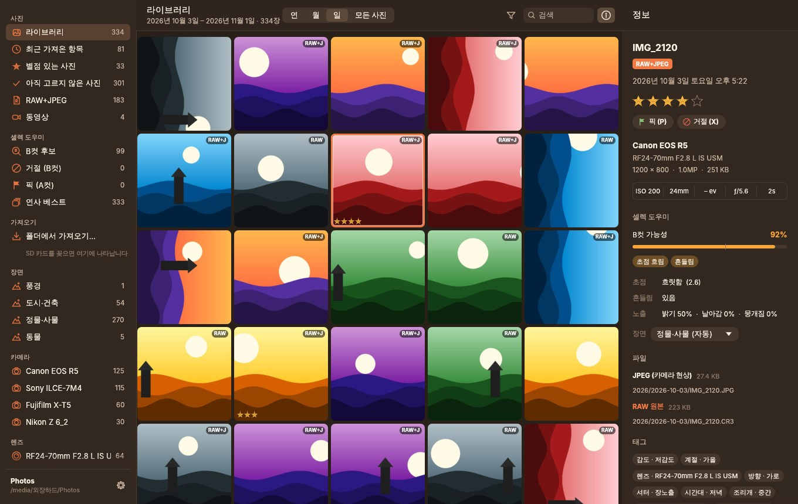
  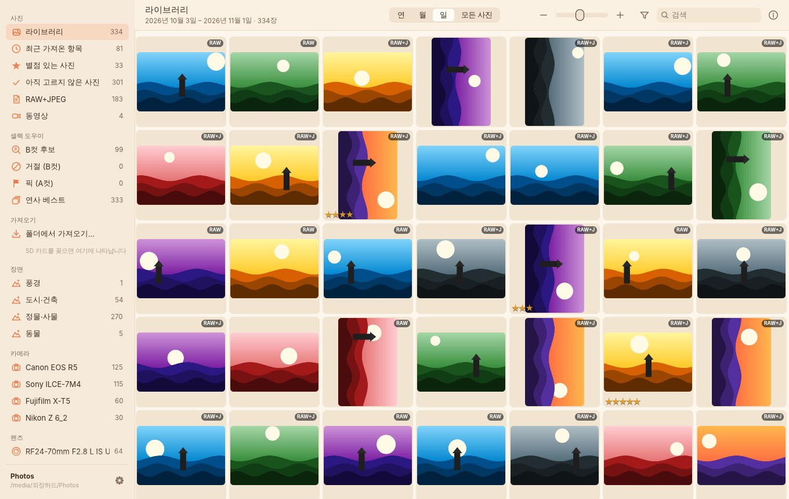
</p>

앱 설정 파일 위치: macOS `~/Library/Application Support/photo-organize/config.json` · Windows `%APPDATA%\photo-organize\config.json` · Linux `~/.config/photo-organize/config.json`

---

## 내 사진은 안전한가요?

- **SD 카드는 읽기만 합니다.** 카드의 파일을 지우거나 바꾸지 않습니다. (추출은 버튼이나 옵션으로 요청할 때만)
- **원본 사진 파일은 절대 수정하지 않습니다.** 별점·태그는 카탈로그와 별도의 `.xmp` 파일에만 기록합니다.
- **B컷으로 거절해도 파일은 그대로입니다.** 거절은 표시일 뿐이고, 지우기 기능은 없습니다.
- **파일을 옮기는 건 [작품 폴더로 모으기](#작품-폴더-라이트룸-등에서-편집하기)에서 '옮기기'를 고를 때뿐입니다.** 라이브러리 안에서 위치만 바꾸고(내용은 그대로), 원래 자리를 기억해 되돌릴 수 있습니다. 한 사진의 RAW · JPEG · XMP 중 하나라도 옮기지 못하면 그 사진은 원래 자리로 돌아갑니다.
- **복사는 임시 파일(`.파일명.part`)에 쓴 뒤 이름을 바꿉니다.** 중간에 케이블이 빠지거나 앱이 꺼져도 반쯤 복사된 사진이 진짜 사진처럼 남지 않습니다.
- **체크섬 검증**: 복사하면서 BLAKE3 체크섬을 계산하고, 디스크에 기록을 확정한 뒤 다시 읽어 비교합니다. 크기나 체크섬이 다르면 그 파일을 실패로 표시하고 남은 파일은 계속 가져옵니다.
- **중복 방지**: 파일명 · 크기 · 촬영 시각으로 빠르게 확인하고, 내용 체크섬으로 한 번 더 확인합니다.
- **가져오기를 중단하면** 반쯤 복사된 사진 묶음은 지우고, 이미 끝난 사진만 라이브러리에 남깁니다.
- **인터넷을 쓰지 않습니다.** 정보 패널의 *지도* 를 누를 때만 브라우저로 지도 페이지를 엽니다. B컷 분석의 얼굴 인식 · 장면 인식 모델도 앱 안에 들어 있어 사진이 밖으로 나가지 않습니다.

**카탈로그를 잃어버렸다면?** `.photo-organize` 폴더가 지워져도 사진은 그대로입니다.
**폴더에서 가져오기…** 로 라이브러리 폴더 자신을 고르면 파일을 복사하지 않고 그 자리에서 다시 카탈로그를 만들고, `.xmp` 에 남아 있던 **별점도 복원**됩니다.

**백업은?** 라이브러리 폴더 전체(숨김 폴더 `.photo-organize` 포함)를 다른 하드로 복사하면 그대로 열립니다.

---

## 지원 형식

| 종류 | 확장자 | 촬영 정보(EXIF) | 썸네일 · 크게 보기 |
|---|---|---|---|
| JPEG | jpg · jpeg | ✅ | ✅ (카메라가 넣어 둔 MPF 미리보기를 우선 사용) |
| Canon | CR3 · CR2 · CRW | ✅ | ✅ 내장 JPEG (CR3: 전체 해상도 · PRVW · THMB) |
| Nikon | NEF · NRW | ✅ | ✅ 내장 JPEG |
| Sony | ARW · SR2 · SRF | ✅ | ✅ 내장 JPEG |
| Fujifilm | RAF | ✅ | ✅ 내장 JPEG |
| Panasonic · Olympus/OM · Pentax · Samsung · Leica · Hasselblad · Phase One | RW2 · ORF · PEF · SRW · DNG · 3FR · IIQ … | ✅ | ✅ 내장 JPEG |
| HEIF | heic · heif · hif | ✅ | 아이콘으로 표시 |
| 동영상 | mp4 · mov · m4v · mts · m2ts · avi … | 파일 시간 | 아이콘으로 표시 |

읽어 오는 정보: 촬영 시각(1/1000초, 시간대) · 카메라 · 렌즈 · 초점거리(35mm 환산 포함) · 조리개 · 셔터 · ISO · 노출보정 · 플래시 · 화이트밸런스 · 측광 · 크기 · 방향 · GPS · 시리얼 · 카메라 별점.
렌즈 모델명을 기록하지 않는 오래된 바디는 렌즈 사양(예: `24-70mm f/2.8`)으로 표시합니다.

---

## 자주 묻는 질문 · 문제 해결

<details>
<summary><b>"악성 코드가 없음을 확인할 수 없습니다" · "손상되었기 때문에 열 수 없습니다"라고 나와요 (macOS)</b></summary>

Apple 공증을 받지 않은 앱이라 생기는 메시지입니다 (무엇이 발견된 것은 아닙니다).
1. 창에서 **완료** → **시스템 설정 → 개인정보 보호 및 보안** 맨 아래 **보안** 의 **그래도 열기** → 암호 → **그래도 열기**.
   (macOS 14 이하는 Finder 에서 **우클릭 → 열기 → 열기**.)
2. *그래도 열기* 버튼이 안 보이거나 *손상되었다* 고 나오면 터미널에서 "인터넷에서 받음" 표시를 지웁니다:
   ```bash
   xattr -dr com.apple.quarantine "/Applications/Photo Organize.app"
   ```
3. 처음부터 경고 없이 설치하려면 [터미널로 설치하기](#macos-맥북--권장) 의 명령을 쓰세요.
</details>

<details>
<summary><b>SD 카드를 꽂았는데 아무 반응이 없어요</b></summary>

- 카드에 `DCIM` 폴더가 있어야 카메라 카드로 인식합니다. (디지털카메라 카드는 모두 있습니다)
- 앱이 카드 목록을 1.5초마다 확인합니다. 잠시 기다려 보세요.
- macOS 에서 *이동식 볼륨* 접근을 거절했다면 **시스템 설정 → 개인정보 보호 및 보안 → 파일 및 폴더 → Photo Organize → 이동식 볼륨**을 켜 주세요.
- 설정의 *"SD 카드를 연결하면 가져오기 화면 열기"* 가 꺼져 있으면 사이드바의 카드 이름을 직접 누르세요.
- 카드 리더가 아닌 폴더라면 **폴더에서 가져오기…** 를 쓰세요.
</details>

<details>
<summary><b>같은 카드를 또 꽂으면 어떻게 되나요?</b></summary>

이미 가져온 사진은 카드 화면에서 `가져옴` 으로 흐리게 표시되고, **새 항목 모두 가져오기**는 새 사진만 복사합니다. *가져온 항목 숨기기* 로 새 사진만 볼 수도 있습니다.
</details>

<details>
<summary><b>예전에 그냥 복사해 둔 사진 폴더도 정리할 수 있나요?</b></summary>

네. **폴더에서 가져오기…** 로 그 폴더를 고르면 SD 카드처럼 날짜별로 **복사해서** 정리합니다. 원래 폴더는 건드리지 않으니, 확인한 뒤 직접 지우시면 됩니다.
고른 폴더가 라이브러리 **안**에 있으면 복사하지 않고 그 자리에서 카탈로그에만 추가합니다.
</details>

<details>
<summary><b>별점은 어디에 저장되나요? Lightroom 에서도 보이나요?</b></summary>

라이브러리의 카탈로그(`.photo-organize/catalog.db`)와 사진 옆의 `.xmp` 사이드카 두 곳에 저장됩니다. Lightroom 에서 라이브러리 폴더를 가져오기(추가)하면 별점이 보입니다. 이미 Lightroom 에 있는 사진이라면 *메타데이터 → 파일에서 메타데이터 읽기* 를 실행하세요.
</details>

<details>
<summary><b>촬영 날짜가 이상하게 나와요</b></summary>

카메라 시계가 틀렸거나, EXIF 가 없는 파일이라 파일 수정 시간을 쓴 경우입니다. 정보 패널에 *EXIF 날짜 없음 · 파일 시간 사용* 이 보이면 후자입니다.
</details>

<details>
<summary><b>썸네일이 안 보이거나 깨져 있어요</b></summary>

설정 → **썸네일 모두 다시 만들기**를 눌러 보세요. HEIF 와 동영상은 원래 아이콘으로만 표시됩니다.
</details>

<details>
<summary><b>외장 하드를 바꾸거나 다른 컴퓨터에서 열고 싶어요</b></summary>

라이브러리 폴더를 통째로(숨김 폴더 포함) 옮긴 뒤, 사이드바 아래의 라이브러리 이름을 눌러 새 위치를 고르면 됩니다. 파일 경로는 라이브러리 기준 상대 경로로 저장되어 있어 드라이브 이름이 달라도 문제없습니다.
</details>

---

## 성능

| 항목 | 수치 |
|---|---|
| 사진 10만 장 라이브러리에서 필터 적용 | ~2 ms |
| 필터별 사진 수(패싯) 계산 | ~2 ms |
| 텍스트 검색 | ~6 ms |
| 썸네일 — RAW 내장 미리보기 · MPF 가 있는 JPEG | 수 ms |
| 썸네일 — 미리보기 없는 24MP JPEG | ~45 ms (여러 코어에서 병렬) |
| B컷 분석 (초점 · 흔들림 · 노출 · 얼굴/눈 · 장면) | 4코어에서 62장 2.5초 (1장 ≈ 40 ms), 백그라운드 |
| 고를 때마다 다시 학습 · 점수 매기기 | 2만 장 ≈ 30 ms + 카탈로그 읽기/쓰기 (사진을 다시 읽지 않음) |

어떻게 빠른가:

- **RAW 를 현상하지 않습니다.** 모든 카메라 RAW 에 들어 있는 미리보기 JPEG 중 필요한 크기 이상에서 가장 작은 것을 골라, JPEG 의 1/2·1/4·1/8 축소 디코딩으로 바로 엽니다.
- **EXIF 는 필요한 바이트만 읽습니다.** 50 MB RAW 를 통째로 읽지 않으므로 수천 장이 든 SD 카드도 몇 초 만에 훑습니다.
- **카드 읽기와 하드 쓰기를 동시에** 합니다(4 MB 단위 파이프라인). 그래서 둘 중 느린 장치의 속도로 복사가 끝납니다.
- 썸네일은 작은 파일 수천 개 대신 **SQLite 파일 하나**에 모아 exFAT 외장 하드에서도 빠릅니다.
- B컷 분석은 RAW 안의 미리보기를 1600px 로 읽어 한 번만 하고, 결과(측정값)를 카탈로그에 저장합니다. 학습은 저장된 측정값만으로 하므로 즉시 끝납니다. 신경망은 순수 Rust 추론 엔진([tract](https://github.com/sonos/tract))으로 CPU 에서 돌립니다.
- 그리드는 **화면에 보이는 썸네일만** 백그라운드에서 디코딩하고, 빠르게 스크롤해 지나간 요청은 버립니다. 크게 보기에서는 앞뒤 사진을 미리 불러옵니다.

---

## 명령줄 도구 `photoorg`

스크립트나 서버, 문제 확인용으로 같은 기능을 명령줄에서도 쓸 수 있습니다.

```bash
photoorg volumes                                         # 연결된 SD 카드 목록
photoorg scan   /Volumes/EOS_DIGITAL /Volumes/HDD/Photos  # 가져오기 전 미리보기 (새 사진·중복 수)
photoorg import /Volumes/EOS_DIGITAL /Volumes/HDD/Photos --raw-subfolder RAW
        # --folders "{YYYY}/{MM}/{DD}"  --names "{YYYY}{MM}{DD}_{orig}"  --no-videos  --no-verify
photoorg list   /Volumes/HDD/Photos --camera r5 --lens 85 --iso 100-800 --focal 35-85 --aperture 1.2-2.8 --min-rating 4 --format raw+jpeg
photoorg stats  /Volumes/HDD/Photos                       # 카메라 · 렌즈 · ISO · 별점 통계
photoorg rate   /Volumes/HDD/Photos 5 12 13 14            # 사진 id 12·13·14 에 별점 5 (XMP 포함)
photoorg export-csv /Volumes/HDD/Photos catalog.csv       # 엑셀용 CSV (UTF-8 BOM)
photoorg export /Volumes/HDD/Photos ~/Desktop/공유 --small 2048 --quality 88 --min-rating 4   # 작게 내보내기
        # --jpeg (JPEG만) · 기본은 원본 전체 · 사진 id 를 나열하면 그 사진만
        # --zip "제주 여행" --split 25 (25 MB 씩 ZIP) · --date-names (이름 앞에 촬영 일시)
photoorg thumbs /Volumes/HDD/Photos [--all]               # 빠진 썸네일 만들기
photoorg analyze /Volumes/HDD/Photos [--all]              # B컷 분석 + 학습 (장면별 학습 현황 출력)
photoorg cull   /Volumes/HDD/Photos --threshold 60        # B컷 후보 목록 (가능성 · 장면 · 이유)
photoorg analyze-file IMG_0001.CR3                        # 사진 한 장의 분석 결과 (디버그)
photoorg info   IMG_0001.CR3                              # EXIF 와 내장 미리보기 정보 (디버그)
```

폴더·파일 이름 템플릿에 쓸 수 있는 값: `{YYYY}` `{YY}` `{MM}` `{DD}` `{hh}` `{mm}` `{ss}` `{camera}` `{make}` `{lens}` `{orig}`

---

## 개발자 안내

### 구조

```
crates/
├── core/   photoorg-core   — 앱과 CLI 가 함께 쓰는 라이브러리
│   ├── tiff.rs        seek 기반 TIFF/IFD 리더 (필요한 바이트만 읽음)
│   ├── metadata.rs    EXIF: JPEG(APP1 · XMP · MPF) · TIFF 계열 RAW · CR3(ISO-BMFF) · RAF · HEIF
│   ├── preview.rs     내장 JPEG 고르기 · DCT 축소 디코딩 · 방향 보정 · 썸네일
│   ├── import.rs      스캔 → RAW/JPEG 묶기 → 계획 → 복사 파이프라인 → 카탈로그 → 썸네일
│   ├── catalog.rs     SQLite 카탈로그 · 썸네일 DB · 메모리 인덱스(LibraryIndex)
│   ├── filter.rs      필터 · 패싯 계산 (rayon 병렬)
│   ├── library.rs     라이브러리 폴더 · XMP 기록
│   ├── export.rs      내보내기: 원본 · JPEG만 · 작게(리사이즈 + EXIF, GPS 제외) · 찍은 순서 · 이름 충돌
│   ├── zip.rs         ZIP 쓰기(무압축, UTF-8 이름, 크기별 나누기)
│   ├── cull/          셀렉 엔진(crates/cull)을 파일 · 카탈로그와 잇는 부분
│   ├── tags.rs · template.rs · xmp.rs · volumes.rs · format.rs · media.rs
├── macos/  photoorg-macos  — Mac App Store판(샌드박스): 고른 폴더 · 카드 기억(보안 범위 북마크) · Finder · 추출
├── cull/   photoorg-cull   — 셀렉 엔진 (BUSL 1.1)
│   ├── metrics.rs     초점(라플라시안) · 흔들림(구조 텐서) · 노출 · dHash
│   ├── vision.rs      YuNet 얼굴 · MobileNetV2 분류 (tract-onnx, 모델 내장)
│   ├── eyes.rs        눈 뜸/감음 추정 · scene.rs 장면 분류 · taste.rs 취향 임베딩
│   ├── learn.rs       특징 · 연사 묶기 · 장면별 로지스틱 회귀 · 기준점 보정
│   ├── eval.rs        교차검증 정확도 (photoorg cull-eval)
│   └── models/        ONNX 모델과 라이선스 (OpenCV Model Zoo)
├── app/    photo-organize  — egui/eframe 데스크톱 앱
│   ├── app.rs         상태 · 백그라운드 작업 · 키보드 · 프레임 루프
│   ├── app_cull.rs    분석 · 재학습 작업, 픽/거절
│   ├── thumbs.rs      비동기 텍스처 캐시 (보이는 것만, 오래된 요청 폐기)
│   ├── layout.rs      그리드 · 연/월 카드 배치
│   ├── views/         sidebar · toolbar · filters · grid · viewer · info · import
│   ├── theme.rs       크림 · 코코아 · 클래식 다크/라이트 팔레트
│   ├── icon.rs        창 아이콘 · 마스코트 (assets/ 의 PNG 내장)
│   ├── license.rs     라이선스 등록 · 서명 토큰 오프라인 확인 (assets/license.json), app_license.rs 설정 화면
│   ├── assets/        앱 아이콘: AppIcon.icns(macOS) · icon.ico(Windows, build.rs 로 exe 에 포함) · PNG
│   └── fonts.rs · widgets.rs
└── cli/    photoorg        — 명령줄 도구

site/       판매 사이트 — Firebase Hosting · Cloud Functions · 토스페이먼츠 (site/README.md)
docs/app-store/  Mac App Store 에 올리기 — 절차 · 등록 문구 · 스크린샷 (scripts/macos-appstore.sh)
```

### 설계에서 신경 쓴 점

- **카탈로그는 라이브러리 폴더 안에.** 경로는 라이브러리 기준 상대 경로라, 외장 하드가 다른 컴퓨터에서 다른 이름으로 붙어도 그대로 열립니다.
- **화면은 메모리 인덱스로.** 시작할 때 카탈로그 전체를 압축된 구조체로 읽어 두고(문자열은 정수로 바꿔 둠), 필터와 패싯을 전부 메모리에서 계산합니다. SQLite 는 저장용입니다.
- **쓰기는 별도 스레드.** 별점 · XMP 기록은 전용 스레드에서 처리해 외장 하드가 느려도 UI 가 멈추지 않습니다.
- **폰트는 OS 의 것.** SF Pro / Segoe UI 와 시스템 한글 글꼴(Apple SD Gothic Neo · 맑은 고딕 · Noto Sans CJK)을 OS 글꼴 데이터베이스에서 찾아 씁니다.
- **macOS 에서는** 타이틀바를 숨기고 콘텐츠를 창 전체로 넓혀, 「사진」 앱처럼 신호등 버튼이 사이드바 위에 떠 있습니다.
- **테마는 아이콘에서.** 크림 · 코코아 테마의 색(종이 크림, 코코아색 선, 체크 배지의 주황, 반짝이의 노랑)은 앱 아이콘 그림에서 뽑았고, 썸네일 모서리도 아이콘의 사진 카드처럼 둥글게 그립니다.

### 테스트

```bash
cargo test --workspace            # 단위 · 통합 테스트
cargo clippy --workspace          # 린트
cargo test --release -p photoorg-core bench_100k -- --ignored --nocapture   # 10만 장 필터 벤치마크
cargo test --release -p photoorg-core bench_score -- --ignored --nocapture  # 2만 장 B컷 학습·점수 벤치마크
PHOTOORG_TEST_IMAGES=<폴더> cargo test -p photoorg-core faces -- --ignored  # 실제 사진으로 얼굴·장면 확인
```

통합 테스트는 임시 폴더에 가짜 SD 카드를 만들어 실제 가져오기 파이프라인을 돌립니다: RAW+JPEG 묶기, 중복 건너뛰기, 이름 충돌, 듀얼 슬롯 병합, RAW 하위 폴더 재카탈로그 + XMP 별점 복원, 쓰기 실패 시 다른 파일에 영향 없음, 중단 시 남는 파일 없음, 내보내기.
셀렉 도우미는 합성 이미지로 초점 · 흔들림 · 어두운 사진 · 노출 · 연사 순위 · 사용자 기준 학습 · 라벨 규칙 · 거절의 XMP 왕복을 확인합니다.

### CI

`.github/workflows/build.yml` 이 PR · `main` 푸시 · `v*` 태그마다 실행됩니다. 첫 `plan` 작업이 릴리스 여부를 정합니다: `v*` 태그 푸시, *Run workflow* 의 `release_tag`, 또는 main 푸시 중 새 버전의 릴리스 노트(`docs/releases/v<버전>.md`)가 있고 그 태그가 아직 없을 때. 그 버전의 릴리스에 파일 4개(dmg · zip · Windows zip · Linux tar.gz) 중 빠진 것이 있으면 다음 main 푸시에서 다시 만들어 채웁니다.
각 빌드 작업은 `scripts/release-upload.sh` 로 릴리스가 없으면 만들고 파일만 올립니다 (기존 릴리스를 수정하지 않음).
**macOS 를 먼저** 빌드(arm64 + x86_64 → `lipo` 유니버설 → `.app` → 서명(`scripts/macos-sign.sh`) → `.dmg`/`.zip`)하고, 이어서 Windows · Linux 를 빌드합니다. 태그 푸시 시 Releases 에 자동 업로드합니다.

### macOS 공증: 경고 없이 열리게 하기

지금 배포되는 맥 앱은 *ad-hoc* 서명이라 처음 열 때 사용자가 한 번 허용해야 합니다. Apple 공증을 받으면 이 과정이 없어집니다. 필요한 것은 **Apple Developer Program 가입(연 $99)** 과 GitHub 저장소 *Settings → Secrets and variables → Actions* 에 넣는 비밀값 5개뿐이고, 나머지는 CI 가 합니다.

| Secret | 만드는 법 |
|---|---|
| `MACOS_CERTIFICATE_P12` | developer.apple.com → Certificates 에서 **Developer ID Application** 인증서를 만들고, 맥의 키체인 접근에서 인증서+개인 키를 `.p12` 로 내보낸 뒤 `base64 -i cert.p12 \| pbcopy` 로 복사한 값 |
| `MACOS_CERTIFICATE_PASSWORD` | `.p12` 를 내보낼 때 정한 암호 |
| `APPLE_ID` | 개발자 계정의 Apple ID (이메일) |
| `APPLE_TEAM_ID` | developer.apple.com → Membership 의 Team ID (10자리) |
| `APPLE_APP_PASSWORD` | appleid.apple.com → 로그인 및 보안 → **앱 암호** 에서 만든 앱 전용 암호 |

값이 있으면 `scripts/macos-sign.sh` 가 Developer ID 로 서명(hardened runtime)하고 `notarytool` 로 공증한 뒤 티켓을 붙입니다(staple). 없으면 지금처럼 ad-hoc 서명만 합니다.

---

## 알려진 제한

- **HEIF/HEIC · 동영상**은 정리 · 필터 · 별점은 되지만 썸네일 대신 아이콘이 표시됩니다 (순수 Rust HEVC 디코더 부재).
- **사진 편집 기능은 의도적으로 없습니다.** 보정은 Lightroom 등에서 하세요. XMP 로 별점이 이어집니다.
- macOS 앱은 **Apple 개발자 서명 · 공증이 되어 있지 않아** 처음 실행할 때 한 번 허용이 필요합니다.
- 동영상의 촬영 날짜는 파일 수정 시간을 씁니다.
- **B컷 찾기**는 합성 · 가공한 테스트 사진으로 검증했습니다. 눈 감음 판단은 휴리스틱이라 실제 사진에서 틀릴 수 있고, 의도한 흔들림 · 소프트 포커스도 후보로 오를 수 있습니다 ([자세히](#얼마나-정확한가요)). HEIF · 동영상은 분석하지 않습니다.
- 얼굴 · 장면 인식 모델이 들어가 앱 크기가 약 15 MB 늘었습니다.

---

## 라이선스

- 앱 · 가져오기 · 카탈로그 등 대부분: [MIT](LICENSE)
- **셀렉 엔진** (`crates/cull` — B컷 · A컷 후보, 학습): 0.3.0부터 [Business Source License 1.1](crates/cull/LICENSE) — 소스는 공개하지만, Photo Organize 앱 안에서 쓰는 것 말고는 상업적 사용이 허용되지 않습니다. 각 버전은 공개 4년 뒤 MIT 로 바뀝니다 (0.4.0 은 2030-11-05). 0.2.6 까지의 코드는 MIT 그대로입니다. 자세한 내용은 [LICENSING.md](LICENSING.md).

셀렉 엔진에 내장된 모델 ([OpenCV Model Zoo](https://github.com/opencv/opencv_zoo), 자세한 내용은 [crates/cull/models](crates/cull/models/README.md)):
- 얼굴 검출 **YuNet** (`face_detection_yunet_2023mar.onnx`) — MIT
- 이미지 분류 **MobileNetV2** (`image_classification_mobilenetv2_2022apr.onnx`) — Apache-2.0
