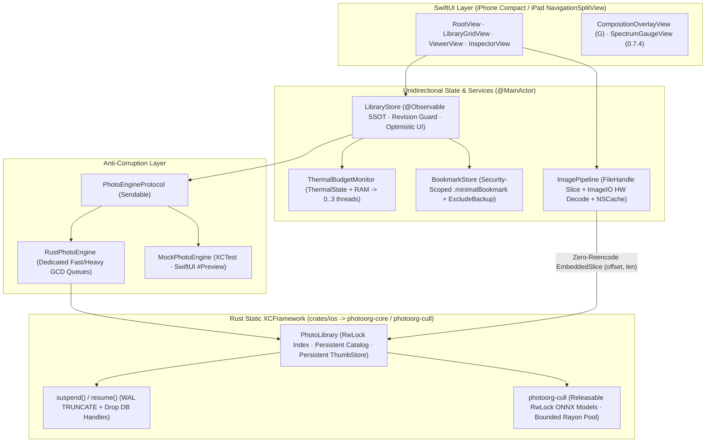

# LOUPE for iOS / iPadOS

촬영 현장에서 아이패드·아이폰에 USB-C SD 카드 리더나 외장 SSD를 꽂아 EXIF 날짜별로 정리하고, **기기 안에서 B컷·A컷을 셀렉**하고, 크롭·수평을 맞춘 뒤 AirDrop · 파일 · Lightroom 으로 바로 넘기는 네이티브 SwiftUI 앱입니다.

- **번들 ID**: `io.github.mj-best.loupe.ios`
- **지원 기기**: iPhone · iPad (iOS 17 / iPadOS 17 이상, Universal)
- **엔진 공유**: 데스크톱(macOS · Windows · Linux)과 동일한 `photoorg-core` · `photoorg-cull` Rust 엔진을 `crates/ios` (`photoorg-ios`) UniFFI 정적 라이브러리(`LoupeCore.xcframework`)로 링크합니다.
- **네트워크 코드 0줄**: 사진과 AI 모델(YuNet · MobileNetV2 · PP-HumanSeg)은 기기 밖으로 나가지 않습니다.

---

## 1. 시스템 아키텍처 — 애플 · 당근 · 토스 엔지니어 관점의 설계 결정



기존 데스크톱/안드로이드 브릿지(`crates/android`)를 그대로 iOS 로 복붙하지 않고, 세 관점에서 치명적으로 지적받을 문제들을 코어(`crates/core`, `crates/cull`)와 iOS 브릿지(`crates/ios`), SwiftUI 레이어(`ios/`)에서 처음부터 구조적으로 해결했습니다.

| 관점 | 그대로 이식했을 때 놀림받을 포인트 | LOUPE iOS/iPadOS 설계 해결책 | 코드 위치 |
|---|---|---|---|
| **Apple** | `trash = "5"` 가 `not(target_os = "android")` 로만 막혀 iOS 빌드 자체가 실패 | `not(any(target_os = "android", target_os = "ios"))` 로 수정, iOS 는 비파괴 라이브러리 휴지통 사용 | `crates/core/Cargo.toml`, `crates/core/src/trash.rs` |
| **Apple** | 백그라운드 전환 시 SQLite WAL 파일 락을 쥔 채 suspend → 커널 **`0xdead10cc` 즉사 크래시** | `scenePhase == .background` 시 작업 취소 → `PRAGMA wal_checkpoint(TRUNCATE)` → `Catalog`·`ThumbStore` 커넥션 완전 드랍 (`suspend()`), 복귀 시 `resume()` | `crates/core/src/catalog.rs`, `crates/ios/src/lib.rs`, `LoupeApp.swift` |
| **Apple** | `OnceLock` ONNX 모델 영구 상주(~100MB+ dirty heap) + `rayon` 전 코어 동시 추론 → **Jetsam OOM & 발열** | `RwLock<Option<Arc<...>>>` + `release_ml_models()` 로 메모리 경고/백그라운드 시 즉시 반납; `ProcessInfo.thermalState`·RAM 기반 스레드 예산(0~3)으로 `analyze_assets_with_threads` 제한 | `crates/cull/src/vision.rs`, `segment.rs`, `ThermalBudgetMonitor.swift` |
| **Apple** | RAW 수십 GB 를 `Documents/` 에 저장하면서 백업 제외 미설정 → **App Store 2.23 리젝** | `URLResourceValues.isExcludedFromBackup = true` 강제 적용 + 외장 SSD 직접 열기(Security-Scoped Bookmark `.minimalBookmark`, 맥 LOUPE 와 카탈로그 100% 호환) | `BookmarkStore.swift` |
| **Apple** | 아이패드에서 폰 화면만 늘려 놓음 | `NavigationSplitView` + 우측 인스펙터 + `UIKeyCommand` 외장 키보드(`F1~F5`, `1~5`, `0`, `P`, `X`, `U`, `Z`, `R`, `G`, `Space×2`, `←/→`, `Delete`, `Esc` + ⌘ 길게 누르기 단축키 HUD) + Haptic + Dynamic Type | `RootView.swift`, `ViewerView.swift`, `HardwareKeyHandler.swift` |
| **당근** | `thumbnail()` 호출마다 `ThumbStore::open` + `PRAGMA WAL` 실행 (스크롤 시 초당 수십 회 DB 오픈 참사) | `PhotoLibrary` 내 전용 상주 `ThumbStore` 커넥션 유지 + `Catalog` 쓰기와 락 분리 | `crates/ios/src/lib.rs` |
| **당근** | `preview()` 가 RAW 내장 JPEG 를 소프트웨어 디코딩 → 재인코딩 → FFI 복사 → UIImage 재디코딩 (3중 낭비) | `PreviewDescriptor::EmbeddedSlice` 로 파일 경로·오프셋·길이만 반환 → Swift `FileHandle` 슬라이스 읽기 + **Apple ImageIO(`CGImageSourceCreateThumbnailAtIndex`) 하드웨어 1회 디코딩** + `byPreparingForDisplay()` | `crates/core/src/preview.rs`, `ImagePipeline.swift` |
| **당근** | 2만 장 라이브러리에서 `photos(view)` 전체 배열을 매번 FFI 직렬화 | `snapshot(view)` 로 ID 배열만 받고, `photos_batch(ids)` 로 화면 가시 윈도우(±40장)만 배치 로드 + 낙관적 UI 업데이트(0ms) + 뷰어 앞뒤 2장 프리페치 + 스크롤 Task 취소 | `crates/ios/src/lib.rs`, `LibraryStore.swift`, `ImagePipeline.swift` |
| **토스** | 분산된 mutable 프로퍼티 + `photos()`/`counts()` 따로 호출 → **스냅샷 불일치(Torn Read) & 레이스 컨디션** | `@MainActor @Observable` 단방향 상태 머신 `LibraryStore` + 단일 Read Lock 원자적 `LibrarySnapshot(ids, counts, learn, revision)` + 스테일 리비전 폐기 + 디바운스 학습 큐 | `LibraryStore.swift`, `StoreTypes.swift` |
| **토스** | 에러가 `Failed { reason: String }` 하나뿐이라 복구 액션 제시 불가 | 구조화된 10종 `PhotoError` (`LibrarySuspended`, `PermissionDenied`, `InsufficientStorage`, `NotAnalyzed` 등) → 에러별 맞춤형 복구 CTA 버튼(`RecoveryAlert`) | `crates/ios/src/lib.rs`, `PhotoEngineProtocol.swift`, `RootView.swift` |
| **토스** | `catalog.lock().unwrap()` FFI 패닉 위험 · UniFFI 타입이 View 전체에 유출 · 관측성 부재 | lock poison 안전 복구, Anti-Corruption Layer(`PhotoEngineProtocol` ↔ `MockPhotoEngine` ↔ `RustPhotoEngine`), `OSLog` + `OSSignposter` 계측, XCTest 단위 테스트 완비 | `crates/core/src/cull/mod.rs`, `PhotoEngineProtocol.swift`, `LoupeTests/` |

---

## 2. 로컬 빌드 및 실행 (macOS + Xcode 16 이상)

```bash
# 1. Rust iOS 타깃 설치 (최초 1회)
rustup target add aarch64-apple-ios aarch64-apple-ios-sim
brew install xcodegen

# 2. Rust 정적 라이브러리 + Swift UniFFI 바인딩 + LoupeCore.xcframework 생성
./ios/Scripts/build-rust-ios.sh --sim-only --debug   # 시뮬레이터 빠른 빌드
# 또는 실기기 포함 릴리스:
./ios/Scripts/build-rust-ios.sh

# 3. Xcode 프로젝트 생성 및 열기
cd ios
xcodegen generate
open Loupe.xcodeproj
```

- Xcode 에서 **Signing & Capabilities → Team** 에 Apple 개발자 팀을 고른 뒤 아이폰/아이패드 시뮬레이터 또는 실기기로 실행합니다.
- 실기기에서 외장 SSD 나 SD 카드 리더를 테스트할 때는 파일 앱에서 카드 폴더를 고르면 즉시 스캔·가져오기·셀렉이 동작합니다.

---

## 3. 남은 과제 (향후 고도화)

- **Core ML / Apple Neural Engine(ANE) 추론 백엔드**: 현재는 `tract-onnx` CPU 추론 + 열 예산 스레드 제한으로 안전하게 동작합니다. 향후 `crates/cull` 의 `vision`/`segment` 추론을 Core ML `.mlpackage` 로 위임하는 어댑터를 붙이면 A17/M-series 기기에서 분석 속도를 5~10배 높이고 발열을 더 줄일 수 있습니다.
- **실기기 프로파일링**: 리눅스 CI 환경에서는 실제 iPhone/iPad 실기기 메모리(Jetsam), USB-C 외장 SSD 분리/재연결, Apple Pencil/Magic Keyboard 단축키 동작을 직접 확인하지 못했습니다. macOS + Xcode 실기기에서 Instruments(Allocations · Time Profiler · Core Animation Hitches)로 확인이 필요합니다.
- **App Store Connect iOS 배포 워크플로**: `app-store.yml`(macOS)처럼 iOS 인증서·프로비저닝 프로필·스크린샷이 준비되면 `ios-app-store.yml` 배포 파이프라인을 추가합니다.
