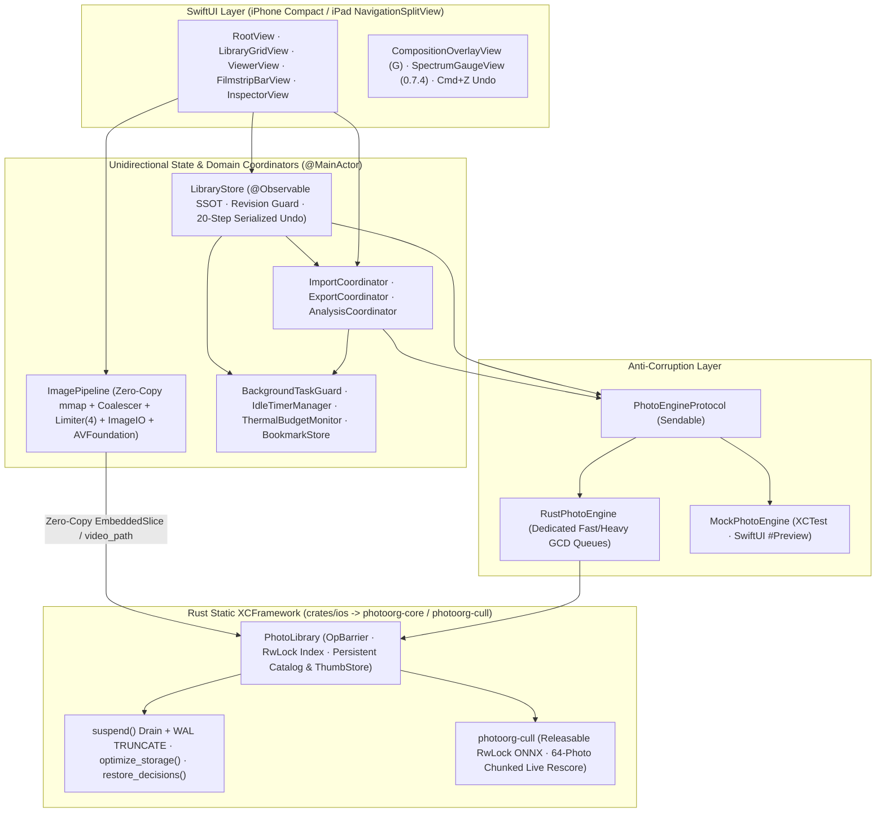

# LOUPE for iOS / iPadOS

촬영 현장에서 아이패드·아이폰에 USB-C SD 카드 리더나 외장 SSD를 꽂아 EXIF 날짜별로 정리하고, **기기 안에서 B컷·A컷을 셀렉**하고, 크롭·수평을 맞춘 뒤 AirDrop · 파일 · Lightroom 으로 바로 넘기는 네이티브 SwiftUI 앱입니다.

- **번들 ID**: `io.github.mj-best.loupe.ios`
- **지원 기기**: iPhone · iPad (iOS 17 / iPadOS 17 이상, Universal)
- **엔진 공유**: 데스크톱(macOS · Windows · Linux)과 동일한 `photoorg-core` · `photoorg-cull` Rust 엔진을 `crates/ios` (`photoorg-ios`) UniFFI 정적 라이브러리(`LoupeCore.xcframework`)로 링크합니다.
- **네트워크 코드 0줄**: 사진과 AI 모델(YuNet · MobileNetV2 · PP-HumanSeg)은 기기 밖으로 나가지 않습니다.

---

## 1. 시스템 아키텍처 — 애플 · 당근 · 토스 엔지니어 관점의 설계 결정



기존 데스크톱/안드로이드 브릿지(`crates/android`)를 그대로 iOS 로 복붙하지 않고, 세 관점에서 치명적으로 지적받을 문제들을 코어(`crates/core`, `crates/cull`)와 iOS 브릿지(`crates/ios`), SwiftUI 레이어(`ios/`)에서 처음부터 구조적으로 해결하고 2차 하드닝까지 완료했습니다.

| 관점 | 그대로 이식했을 때 놀림받을 포인트 | LOUPE iOS/iPadOS 설계 해결책 | 코드 위치 |
|---|---|---|---|
| **Apple** | `trash = "5"` 가 `not(target_os = "android")` 로만 막혀 iOS 빌드 자체가 실패 | `not(any(target_os = "android", target_os = "ios"))` 로 수정, iOS 는 비파괴 라이브러리 휴지통 사용 | `crates/core/Cargo.toml`, `crates/core/src/trash.rs` |
| **Apple** | 백그라운드 전환 시 실행 중인 작업이 새 SQLite 커넥션을 쥔 채 suspend → **`0xdead10cc` 크래시** | `OpBarrier`(RAII `OpGuard` + `Condvar`)로 모든 FFI DB 작업 완전 드레인 → `PRAGMA wal_checkpoint(TRUNCATE)` → 커넥션 드랍; iOS 측은 `BackgroundTaskGuard`(`beginBackgroundTask`)로 종료 시간 보장 + 설정에서 수동 `optimize_storage()` 제공 | `crates/ios/src/lib.rs`, `BackgroundTaskGuard.swift`, `LibraryStore.swift` |
| **Apple** | 백그라운드 진입 시 분석 취소로 `analysisProgress == nil` 되어 `BGProcessingTask` 미예약 · 대용량 가져오기 중 자동 잠금 | `AnalysisCoordinator.hasPendingBackgroundAnalysis` 를 취소 전 보존해 `BGProcessingTask` 확실히 예약 + `TaskCompletionGate` 로 이중 완료 방지; 레퍼런스 카운팅 `IdleTimerManager` 로 가져오기/내보내기 중 자동 잠금 차단 | `AnalysisCoordinator.swift`, `LoupeApp.swift`, `BackgroundTaskGuard.swift` |
| **Apple** | `OnceLock` ONNX 모델 영구 상주(~100MB+ dirty heap) + `rayon` 전 코어 동시 추론 → **Jetsam OOM & 발열** | `RwLock<Option<Arc<...>>>` + `release_ml_models()` 로 메모리 경고/백그라운드 시 즉시 반납; `ProcessInfo.thermalState`·RAM 기반 스레드 예산(0~3)으로 `analyze_assets_with_threads` 제한 | `crates/cull/src/vision.rs`, `segment.rs`, `ThermalBudgetMonitor.swift` |
| **Apple** | RAW 수십 GB 를 `Documents/` 에 저장하면서 백업 제외 미설정 → **App Store 2.23 리젝** | `URLResourceValues.isExcludedFromBackup = true` 강제 적용 + 외장 SSD 직접 열기(Security-Scoped Bookmark `.minimalBookmark`, 맥 LOUPE 와 카탈로그 100% 호환) | `BookmarkStore.swift` |
| **Apple** | 아이패드에서 폰 화면만 늘려 놓음 · 동영상 썸네일 공백 | `NavigationSplitView` + 우측 인스펙터 + 하단 필름스트립(`FilmstripBarView`) + `UIKeyCommand` 외장 키보드(`F1~F5`, `1~5`, `0`, `P`, `X`, `U`, `Z`, `⌘Z`, `R`, `G`, `Space×2`, `←/→`, `Delete`, `Esc` + ⌘ HUD) + `AVAssetImageGenerator` 동영상 썸네일 + Haptic + 인터랙티브 스와이프 피드백 | `RootView.swift`, `ViewerView.swift`, `FilmstripBarView.swift`, `HardwareKeyHandler.swift`, `ImagePipeline.swift` |
| **당근** | `thumbnail()` 호출마다 `ThumbStore::open` + 스크롤 바운스 시 동일 ID 중복 디코딩·30개 동시 디코드 폭주 | 상주 `ThumbStore` 커넥션 + `ThumbnailCoalescer`(waiter `Set<UUID>` 기반 중복 요청 병합) + `DecodeLimiter(max 4)` 동시 디코드 상한 | `crates/ios/src/lib.rs`, `ImagePipeline.swift` |
| **당근** | `preview()` 가 RAW 내장 JPEG 를 소프트웨어 재인코딩 + `FileHandle` 힙 복사 + 크롭 시 이웃 프리뷰 캐시까지 전량 비움 | `PreviewDescriptor::EmbeddedSlice` → **`Data(contentsOf:options:.mappedIfSafe)` 제로카피 mmap 슬라이스** + Apple ImageIO 1회 디코딩 + `byPreparingForDisplay()` + `previewKeysByPhotoID` 정밀 무효화(이웃 프리페치 캐시 보존) | `crates/core/src/preview.rs`, `ImagePipeline.swift` |
| **당근** | 2만 장 라이브러리에서 전체 배열 FFI 직렬화 + 수천 장 분석 완료까지 후보 목록이 비어 있음 | `snapshot(view)` ID 배열 + `photos_batch(ids)` 가시 윈도우(±48장) 로드 + **64장 단위 증분 분석·실시간 재채점**으로 촬영본 분석 도중에도 B컷·A컷 후보 즉시 반영 | `crates/ios/src/lib.rs`, `AnalysisCoordinator.swift`, `LibraryStore.swift` |
| **토스** | `LibraryStore` 비대화(God Object) + 분산 mutable 상태의 Torn Read + 일괄 거절 후 복구 불가 | 도메인 코디네이터 분리(`ImportCoordinator` · `ExportCoordinator` · `AnalysisCoordinator`) + 단일 Read Lock 원자적 `LibrarySnapshot` + 스테일 리비전 폐기 + **20단계 직렬화 배치 Undo**(`restore_decisions` + `⌘Z` + 하단 띠 "되돌리기") | `LibraryStore.swift`, `ImportCoordinator.swift`, `ExportCoordinator.swift`, `AnalysisCoordinator.swift` |
| **토스** | 에러가 `Failed { reason: String }` 하나뿐이라 복구 액션 제시 불가 | 구조화된 10종 `PhotoError` (`LibrarySuspended`, `PermissionDenied`, `InsufficientStorage`, `NotAnalyzed` 등) → 에러별 맞춤형 복구 CTA 버튼(`RecoveryAlert`) | `crates/ios/src/lib.rs`, `PhotoEngineProtocol.swift`, `RootView.swift` |
| **토스** | `catalog.lock().unwrap()` FFI 패닉 위험 · UniFFI 타입 유출 · 관측성 부재 | 프로덕션 FFI 경로 unwrap/panic 0, Anti-Corruption Layer(`PhotoEngineProtocol` ↔ `MockPhotoEngine` ↔ `RustPhotoEngine`), `OSLog` + `OSSignposter` 계측, Rust 동시성/드레인 테스트 + Swift XCTest 완비 | `crates/core/src/cull/mod.rs`, `crates/ios/src/lib.rs`, `LoupeTests/` |

---

## 2. 로컬 빌드 및 실행 (macOS + Xcode 16 이상)

```bash
# 1. Rust iOS 타깃 설치 (최초 1회)
rustup target add aarch64-apple-ios aarch64-apple-ios-sim
brew install xcodegen

# 2. Rust 정적 라이브러리 + Swift UniFFI 바인딩 + LoupeCore.xcframework 생성
./ios/Scripts/build-rust-ios.sh --sim-only --debug   # 시뮬레이터 빠른 빌드
# 또는 실기기 포함 릴리스:
./ios/Scripts/build-rust-ios.sh

# 3. Xcode 프로젝트 생성 및 열기
cd ios
xcodegen generate
open Loupe.xcodeproj
```

- Xcode 에서 **Signing & Capabilities → Team** 에 Apple 개발자 팀을 고른 뒤 아이폰/아이패드 시뮬레이터 또는 실기기로 실행합니다.
- 실기기에서 외장 SSD 나 SD 카드 리더를 테스트할 때는 파일 앱에서 카드 폴더를 고르면 즉시 스캔·가져오기·셀렉이 동작합니다.

---

## 3. App Store Connect 빌드 · 업로드 (GitHub Actions 권장)

iOS / iPadOS 앱스토어용 `.ipa` 패키징에는 macOS + Xcode 16+ 서명 환경이 필요합니다. 기존 Mac App Store 용으로 등록해 둔 시크릿(`MAS_APP_CERT_P12`, `MAS_CERT_PASSWORD`, `APPLE_TEAM_ID`, `ASC_KEY_ID`, `ASC_ISSUER_ID`, `ASC_KEY_P8`)을 그대로 재사용합니다.

### 사전에 적용된 App Store ITMS 필수 요건
- **Privacy Manifest ([`PrivacyInfo.xcprivacy`](../../ios/Loupe/Resources/PrivacyInfo.xcprivacy))**: 추적 없음 · 데이터 수집 없음 + Required Reason API 선언(`UserDefaults CA92.1`, `DiskSpace E174.1/85F4.1`, `FileTimestamp C617.1/3B52.1/DDA9.1`) — `ITMS-91053` 대응.
- **불투명 1024×1024 RGB 앱 아이콘**: 알파 채널을 제거한 24-bit RGB PNG — `ITMS-90717` 대응 (`ios/Scripts/sync-assets.sh` 가 자동 유지).
- **비암호화 수출 규정**: `Info.plist` 에 `ITSAppUsesNonExemptEncryption = false`.
- **정적 XCFramework 비임베드 & dSYM 포함**: `LoupeCore.xcframework` 는 정적 링크(`embed: false`)만 수행하고 Release `dwarf-with-dsym` 으로 크래시 심볼을 포함.
- **iCloud 백업 제외**: `Documents/LOUPE` 에 `isExcludedFromBackup = true` 강제 적용 (App Review 2.23).

### 번들 ID 선택 (통합 구매 vs 별도 앱)
- **맥 LOUPE 와 통합 구매(Universal Purchase)**: App Store Connect 의 기존 Mac LOUPE 앱(`io.github.mj-best.loupe`) 화면에서 **+ iOS 앱** 을 추가하고, 워크플로 실행 시 `bundle_id` 에 **`io.github.mj-best.loupe`** 를 입력합니다.
- **별도 iOS / iPadOS 앱으로 판매**: Apple Developer 에서 App ID **`io.github.mj-best.loupe.ios`** 를 등록하고 App Store Connect 에서 새 iOS 앱을 만든 뒤 기본값(`io.github.mj-best.loupe.ios`)으로 실행합니다.

### GitHub Actions 로 빌드 및 업로드
1. `main` 브랜치에 iOS 코드와 워크플로가 머지된 뒤, 저장소 **Actions → `ios-app-store` → Run workflow** 를 실행합니다.
   - `upload`: `true` 로 두면 서명된 `.ipa` 를 만들고 `xcrun altool --validate-app` · `--upload-app` 으로 App Store Connect 에 바로 올립니다 (`false` 면 아티팩트 `loupe-ios-appstore` 로 `.ipa` 만 내려받아 Transporter 로 직접 올릴 수 있습니다).
   - `bundle_id`: 통합 구매(`io.github.mj-best.loupe`) 또는 별도 앱(`io.github.mj-best.loupe.ios`).
   - (선택) 수동 프로비저닝 프로필을 쓰려면 Apple Developer 에서 **iOS App Store Connect** 배포 프로필(`.mobileprovision`)을 받아 base64 로 GitHub 시크릿 `IOS_PROVISIONING_PROFILE` 에 넣습니다. 비워 두면 기존 `MAS_APP_CERT_P12` + `ASC_*` API 키로 Xcode 자동 배포 서명을 시도합니다.
2. 업로드 뒤 15–30분 후 App Store Connect(TestFlight / App Store 버전)에서 빌드를 선택하고 [listing.md](listing.md) · [privacy.md](privacy.md) 내용을 채워 제출합니다.

### Mac 에서 직접 빌드 / 드라이런
```bash
# 인증서 없이 Release arm64 아카이브 + ITMS 사전 점검만 실행
ios/Scripts/ios-appstore.sh --dry-run

# 서명된 .ipa 생성 및 App Store Connect 업로드
TEAM_ID=ABCDE12345 \
BUNDLE_ID=io.github.mj-best.loupe.ios \
PROFILE=~/Downloads/LOUPE_iOS_AppStore.mobileprovision \
ASC_KEY_ID=... ASC_ISSUER_ID=... \
ios/Scripts/ios-appstore.sh --upload
```

---

## 4. 남은 과제 (향후 고도화)

- **Core ML / Apple Neural Engine(ANE) 추론 백엔드**: 현재는 `tract-onnx` CPU 추론 + 열 예산 스레드 제한으로 안전하게 동작합니다. 향후 `crates/cull` 의 `vision`/`segment` 추론을 Core ML `.mlpackage` 로 위임하는 어댑터를 붙이면 A17/M-series 기기에서 분석 속도를 5~10배 높이고 발열을 더 줄일 수 있습니다.
- **실기기 프로파일링**: 리눅스 환경에서는 실제 iPhone/iPad 실기기 메모리(Jetsam), USB-C 외장 SSD 분리/재연결, Apple Pencil/Magic Keyboard 단축키 동작을 직접 확인하지 못했습니다. TestFlight 배포 후 실기기 및 Xcode Instruments(Allocations · Time Profiler · Core Animation Hitches)로 확인이 필요합니다.
